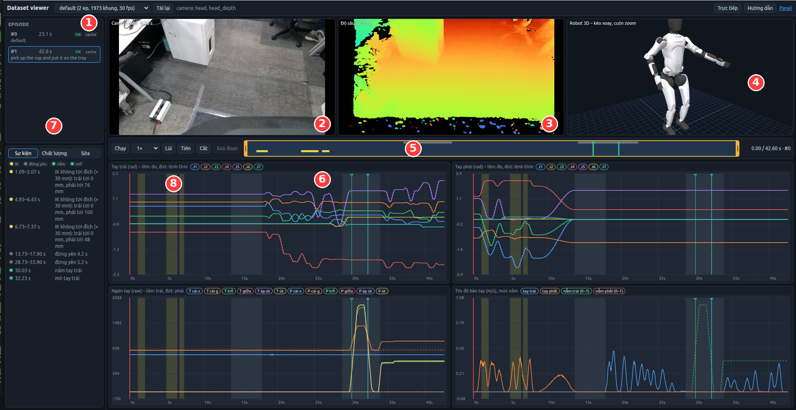

# Thu dữ liệu teleop và xuất bộ dữ liệu train

Dành cho người vận hành AGIBOT A2 Ultra. Đi từ lúc ghi một lần thao tác tới lúc có bộ dữ liệu để train. Mọi thứ chạy trên laptop (`main.py`); robot không lưu gì.

Cập nhật 18/11. Chỗ nào chưa thử trên robot thật có ghi **(chưa thử trên robot)**.

---

## 1. Hiểu nhanh

| Từ | Nghĩa | Ví dụ |
|---|---|---|
| **Episode** (tập) | Một lần làm trọn một việc, ví dụ "nhặt cốc đặt lên khay", khoảng 10–60 s. Mỗi lần nhấn **B** bắt đầu rồi nhấn **B** kết thúc là một tập. | `recordings/pick_cup/2026-11-18/ep_0005/` (một tập ghi vào `pick_cup` task hôm 18/11) |
| **Task** | Tên nhóm việc, ví dụ `pick_cup`. Cũng là tên thư mục và tên bộ dữ liệu. | `pick_cup`, `place_cup`, `stack_blocks` |
| **Instruction** | Câu mô tả cho mô hình, tiếng Anh, ví dụ `pick up the cup and put it on the tray`. | `pick up the cup and put it on the tray` |
| **Bản thô** | Những gì máy ghi lúc thao tác, ở `recordings/`. Đây là bản gốc. | File: `robot.jsonl` (góc khớp), `teleop.jsonl` (lệnh VR), `images.jsonl` (ảnh) |
| **Bộ dữ liệu** (LeRobot) | Bản đã xử lý để train, ở `lerobot_datasets/`. Tự sinh từ bản thô. | `lerobot_datasets/pick_cup/` chứa `data/`, `videos/`, `meta/` |

Mô hình học: **ảnh + trạng thái robot + câu lệnh → lệnh tiếp theo cho robot**. Trong dữ liệu, "observation" là robot đang thế nào (ảnh, góc khớp...), "action" là lệnh đưa cho robot.

### File parquet là gì?

Parquet là **một dạng file bảng số**, giống Excel nhưng nhỏ gọn và đọc rất nhanh. Trong bộ dữ liệu, `data/.../file-000.parquet` là bảng lớn: **mỗi dòng là một khung hình** (30 khung mỗi giây), mỗi cột là một số liệu (góc khớp, lệnh, thời gian...). Bạn **không cần mở nó**: chỉ cần xem qua trang Dataset hoặc đọc bằng Python (mục 3.3). Ảnh camera thì nằm riêng ở các file `.mp4`.

---

## 2. Ghi dữ liệu

**Trước khi ghi:** ở thẻ **Data Recording** trên panel web, điền **Task** (tên ngắn, không dấu, không khoảng trắng, ví dụ `pick_cup`) và **Instr.** (câu lệnh tiếng Anh). Đổi Task là ghi sang bộ khác.

**Một tập:**

| Bước | Thao tác | Ví dụ |
|---|---|---|
| 1 | Đưa tay về tư thế bắt đầu, đặt vật đúng chỗ | Đặt tay ở độ cao ngang ngực, cốc đứng trên bàn trước mặt |
| 2 | **Nhấn nhanh B** (dưới 0,5 s). Tay cầm rung 1 nhịp, web hiện chấm đỏ **REC** | Web báo: `LeRobot: recording pick_cup` |
| 3 | Làm việc. Trigger (+ Grip) để di chuyển tay, **kéo cần gạt xuống để nắm, đẩy lên để mở** | Nhấc cốc lên, di chuyển tới khay, cắm cốc vào khe |
| 4 | **Nhấn nhanh B** lần nữa. Tay cầm rung 2 nhịp, tập được đóng lại | Web báo: `LeRobot: export of 'pick_cup' in 10 s` |
| 5 | Nếu làm hỏng: bấm **Discard last** trên web. File không bị xoá, chỉ bị đánh dấu bỏ | Bấm nút trên Dataset viewer, tập bị đánh dấu `Discard` |

- Thẻ báo `NO ROBOT DATA yet`: receiver chưa chạy hoặc là bản cũ. Sửa trước khi ghi tiếp.
- Dừng khẩn cấp: E-Stop vật lý hoặc nút E-STOP trên web.

**Ghi cho tốt:**
- Mỗi tập một việc, đủ đầu đủ cuối, bắt đầu và kết thúc ở tư thế nghỉ.
- Di chuyển vừa phải (khoảng 0,2–0,3 m/s). Giữ tay gần thân, ngang ngực (tay A2 với được khoảng 0,5 m từ vai).
- Luôn ở trạng thái **ENGAGED** khi ghi.
- Bỏ ngay lần hỏng. Ít tập tốt hơn nhiều tập lẫn lỗi.

**Máy ghi gì:** góc khớp, lệnh gửi robot, ngón tay, tư thế tay cầm, và **ảnh camera đầu (màu + độ sâu) luôn ở độ phân giải 1280×720**, tối đa 15 ảnh/s. Mỗi 25 s khoảng 180 MB. Nếu ảnh bị giật hoặc thưa (Orin quá tải) thì chạy `REC_DEPTH_WIDTH=640 python main.py`, nhưng khi đó ảnh sẽ không còn 1280×720 **(chưa thử trên robot)**.

---

## 3. Dữ liệu sau khi ghi: nơi lưu, xuất, xem và sửa

### 3.1 Dữ liệu nằm ở đâu

```
~/a2_ws/
  recordings/        BẢN THÔ, sinh ra khi nhấn B  (recordings/<task>/<ngày>/ep_.../)
  lerobot_datasets/  BỘ TRAIN, tự sinh từ recordings  (lerobot_datasets/<task>/)
```

1. **`recordings/` là gốc.** Mất `lerobot_datasets/` thì xuất lại được; mất `recordings/` là mất hẳn. Hãy sao lưu `recordings/`.
2. Tên bộ dữ liệu là tên Task: `pick_cup` cho ra `lerobot_datasets/pick_cup`.
3. Nhấn B dừng ghi xong **không cần chạy gì thêm**: khoảng 10 s sau, tập tự được thêm vào bộ.

Xem tổng quan bằng một lệnh: `venv/bin/python tools/data_status.py` (liệt kê từng tập, kết quả OK / CHECK / BAD, tập đã vào bộ nào).

### 3.2 Tự động xuất sang bộ dữ liệu

Việc này diễn ra **một mình** sau mỗi lần nhấn B dừng ghi. Bạn không phải chạy lệnh nào.

**Các bước, theo thứ tự**

| Bước | Điều gì xảy ra | Ví dụ |
|---|---|---|
| 1 | Bạn nhấn B dừng ghi. Tập thô được đóng lại trong `recordings/` (file `meta.json` ghi thời lượng, task, câu lệnh). Thẻ Data Recording hiện `LeRobot: export of '<task>' in 10 s` | File: `recordings/pick_cup/2026-11-18/ep_0005/meta.json` với `"duration": 25.5, "task": "pick_cup", "instruction": "pick up the cup and put it on the tray"` |
| 2 | Máy **chờ 10 giây** để bạn kịp bấm **Discard last** nếu vừa làm hỏng. Máy cũng chờ tới lúc **không còn tập nào đang ghi**: nếu bạn bắt đầu ghi tập mới trong lúc chờ, việc xuất được hoãn cho tới khi tập đó dừng | Nếu bạn nhấn B lúc 11:30:00, nó chờ tới 11:30:10. Nếu bạn nhấn B ghi tập khác lúc 11:30:05, nó tiếp tục chờ tập mới dừng |
| 3 | Máy chạy `tools/export_lerobot.py` như **một tiến trình riêng, ưu tiên thấp** (không làm chậm robot hay laptop điều khiển): `nice 19`, chỉ 2 luồng tính toán, mỗi lúc chỉ một lần xuất. Thẻ hiện `LeRobot: exporting '<task>' -> lerobot_datasets/<task> ...` | Dòng log: `[2026-11-18 11:30:15] Exporting pick_cup (nice 19, 2 workers)` |
| 4 | Tiến trình đọc **mọi tập thô của task đó**, bỏ những tập không cần, rồi **nối các tập mới** vào cuối `lerobot_datasets/<task>`. Lần đầu tiên của một task thì bộ được tạo mới | Lần đầu: tạo mới thư mục và tất cả file. Lần sau: thêm tập mới vào file parquet và video có sẵn |
| 5 | Thẻ báo kết quả (bảng "Thông báo trên thẻ" bên dưới) | Web báo: `LeRobot: added to lerobot_datasets/pick_cup - view it on /dataset` |

Lệnh tương đương mà máy tự chạy: `export_lerobot.py --task <task> --out lerobot_datasets/<task> --repo-id local/<task> --append`.

**Tập nào bị bỏ qua (không vào bộ)**

| Lý do | Giải thích | Ví dụ |
|---|---|---|
| Đã đánh dấu bỏ | Bạn bấm Discard last, hoặc tick "Bỏ episode" ở trang Dataset. File vẫn còn trong `recordings/`, chỉ không được xuất | Tập ep_0003 bị đánh dấu `"discard": true` trong `meta.json` |
| Đã có trong bộ | Máy so đường dẫn của tập thô với danh sách trong `meta/a2_sources.json`, nên một tập không bị thêm hai lần | File nguồn `recordings/pick_cup/2026-11-18/ep_0005/` đã được ghi vào `meta/a2_sources.json` |
| Thiếu dữ liệu | Dưới 10 dòng dữ liệu robot hoặc dưới 10 dòng teleop (thường do receiver trên Orin không chạy), hoặc thiếu vị trí ngón tay, lệnh ngón tay, hay tư thế bàn tay | Log: `[skip] ep_0007: missing hand_pose (only 5 frames with data)` |
| Robot không hề cử động | Cả tập không có lúc nào tay hay ngón di chuyển | Tập khoảng 30 s nhưng tay không di chuyển quá 1 mm, ngón không thay đổi |
| Quá ngắn | Sau khi cắt còn dưới 2 khung hình | Sau cắt đứng yên còn 1 khung (0,033 s), bị bỏ |

Mỗi tập bị bỏ qua được in ra một dòng `[skip] <thư mục>: <lý do>` trong log của `main.py`.

**Xử lý từng tập (bên trong)**

1. **Đọc dữ liệu thô.** Đọc `robot.jsonl`, `teleop.jsonl`, `images.jsonl`. Bỏ qua dòng hỏng (ví dụ dòng cuối bị cắt dở khi tắt máy đột ngột).
   - Ví dụ: Từ ep_0005 đọc 1073 dòng robot, 1065 dòng teleop, 300 ảnh.

2. **Căn đồng hồ.** Robot và laptop có đồng hồ riêng. Máy dùng dấu thời gian của bộ điều khiển robot (trừ đi độ lệch đã đo) nếu nó khớp với đồng hồ Orin; nếu không khớp thì dùng giờ laptop nhận được. Lựa chọn này ghi trong log (`robot clock: mc_stamp` hoặc `laptop_arrival`).
   - Ví dụ: Log báo `[ok] ep_0005: robot clock: mc_stamp` → dùng đồng hồ bộ điều khiển.

3. **Cắt đứng yên ở đầu và cuối.** Một lúc được coi là "đang hoạt động" nếu **một trong ba** điều xảy ra (đã làm trơn khoảng 0,1 giây để bớt nhiễu):
   - bàn tay robot đo được di chuyển nhanh hơn **5 mm/giây**;
   - mục tiêu của bàn tay di chuyển nhanh hơn **5 mm/giây**;
   - lệnh ngón tay đổi nhanh hơn **50 đơn vị/giây**.

   Mọi thứ trước lúc hoạt động đầu tiên và sau lúc hoạt động cuối cùng bị bỏ, **trừ 0,5 giây giữ lại ở mỗi đầu**. Log in `[trim] ... cut 1.2 s idle at the start, 0.0 s at the end`.
   - Ví dụ: Tập ghi từ 0 đến 25,5 s, hoạt động từ 1,2 s đến 24,8 s, nên cắt lại từ 0,7 s đến 25,3 s.

4. **Áp dụng phần bạn đã sửa** trên trang Dataset: điểm cắt đầu / cuối (`trim`) và các đoạn cắt (`cuts`). Máy lấy phần giao của mọi giới hạn, nên điểm cắt của bạn chỉ có thể thu hẹp thêm, không mở rộng ra ngoài phần đã tự cắt.
   - Ví dụ: Nếu bạn cắt thêm từ 2 s đến 5 s, khoảng hoạt động từ 0,7 s đến 25,3 s sẽ trở thành 0,7–2 s và 5–25,3 s (bỏ giữa), hay nếu cắt đầu từ 1 s thì từ 1–25,3 s.

5. **Lấy mẫu 30 khung/giây.** Máy tạo một dãy thời điểm cách đều 1/30 giây. Với mỗi thời điểm, mỗi nguồn dữ liệu cho **mẫu mới nhất có tại hoặc ngay trước thời điểm đó**. Camera 15 ảnh/giây nên mỗi ảnh lặp lại ở 2 khung liên tiếp. Các khung rơi vào đoạn cắt của bạn bị bỏ, hai phần còn lại nối liền.
   - Ví dụ: 25,3 s × 30 fps = 759 khung bộ dữ liệu (nếu không có đoạn cắt giữa). Nếu cắt bỏ 3 s giữa → 759 − 90 = 669 khung.

6. **Đưa ảnh về 1280×720.** Ảnh màu được nội suy mượt, ảnh độ sâu dùng "điểm gần nhất" để không tạo ra giá trị khoảng cách không có thật. Tập ghi ở 640×360 bị phóng lên.
   - Ví dụ: Tập từ 640×360 phóng lên 1280×720. Tập từ 1280×720 giữ nguyên (không phóng thêm).

7. **Ghi vào bộ.** Mỗi khung ghi một dòng vào bảng parquet, và ảnh được mã hoá thành video.
   - Ví dụ: 669 khung → 669 dòng mới trong `data/chunk-000/file-000.parquet`, nối vào cuối bảng; video mã AV1 / HEVC được nối vào file video có sẵn.

**Điều kiện để một trường có mặt trong bộ**

Một số trường chỉ được đưa vào nếu **mọi tập** của lần xuất đều có, để các tập trong cùng bộ luôn cùng cấu trúc:

| Trường | Chỉ có khi | Ví dụ |
|---|---|---|
| `observation.velocity`, `observation.effort` | mọi tập có vận tốc / mô-men khớp | Tập ep_0005 có cả 2 → được đưa vào nếu mọi tập khác cũng có |
| `observation.neck` | mọi tập có dữ liệu cổ | Tập ep_0005 thiếu dữ liệu cổ → cột này không xuất |
| `observation.hand_effort_raw` | mọi tập có lực ngón tay và cùng độ dài | Tập ep_0005 có 12 số lực ngón, tập ep_0006 có 10 số → không xuất cột này |
| 18 số tay cầm VR trong `observation.state` | mọi tập có tư thế tay cầm (và không dùng `--no-controller-pose`). Thiếu thì `state` còn 44 số và log báo `[warn]` | Mọi tập có tay cầm → state 62 số. Tập nào thiếu → state 44 số và log `[warn]: 1 episode missing controller_pose` |
| Ảnh màu / độ sâu | mọi tập có camera đó. Không có ảnh màu ở mọi tập thì xuất không ảnh và log báo, bộ đó không dùng được cho mô hình nhìn | ep_0005 có camera màu, ep_0006 thiếu → không xuất video màu, chỉ có độ sâu |
| `action` lấy từ lệnh Orin | tập có lệnh Orin. Thiếu thì dùng mục tiêu IK của laptop cho tập đó và log báo `[warn]` | Mọi tập có receiver → dùng lệnh Orin. Tập thiếu → dùng mục tiêu laptop cho tập đó (log `[warn]`) |

**Khi nối vào bộ có sẵn (append)**

- Tập mới phải **cùng cấu trúc và cùng cỡ ảnh** với bộ cũ. Nếu khác (ví dụ bộ cũ không có độ sâu, hoặc bộ cũ là 640×360), máy dừng, báo `cannot append ...` và **không ghi gì**. Cách xử lý ở mục 4.1.
- Bộ xuất **trước ngày 17/11** không có `a2_sources.json` nên **không nối thêm được**. Phải xuất lại từ đầu (không dùng `--append`).

**Thông báo trên thẻ Data Recording**

| Thông báo | Nghĩa | Ví dụ |
|---|---|---|
| `LeRobot: export of '<task>' in 10 s` | Đang chờ | Vừa nhấn B dừng ghi task `pick_cup` |
| `LeRobot: exporting '<task>' -> lerobot_datasets/<task> ...` | Đang xuất | 10 s chờ hết, bắt đầu chạy export_lerobot.py |
| `LeRobot: added to lerobot_datasets/<task> - view it on /dataset` | Xong, đã thêm tập mới | Tập mới được nối vào bộ, có thể xem luôn |
| `LeRobot: up to date: lerobot_datasets/<task>` | Không có tập mới để thêm | Tập vừa ghi đã được xuất lần trước (trùng lặp hoặc bị bỏ) |
| `LeRobot: FAILED: ... (lý do)` | Lỗi, lý do nằm trong ngoặc. Xem mục 4.1 | `LeRobot: FAILED: cannot append (different image size)` |
| `LeRobot: auto export off: venv_lerobot missing` | Chưa cài môi trường xuất. Xem mục 4.1 | Chạy: `uv venv --python 3.12 venv_lerobot && uv pip install --python venv_lerobot/bin/python "lerobot[dataset-viz]==0.7.0"` |

**Mất bao lâu:** vài phút cho mỗi tập, lâu hơn khi tập dài hoặc ảnh 1280×720, vì phải mã hoá video. Con số thực tế trên robot **chưa đo** (chưa thử trên robot).

**Tắt hoặc chỉnh:** `A2_AUTO_EXPORT=0 python main.py` (tắt), `A2_AUTO_EXPORT_DELAY_S=30` (chờ lâu hơn).

**Xuất tay** (làm lại từ đầu, bỏ ảnh độ sâu, đổi cỡ ảnh...):

```bash
venv_lerobot/bin/python tools/export_lerobot.py --task pick_cup --out lerobot_datasets/pick_cup --repo-id local/pick_cup
```

| Tuỳ chọn | Tác dụng | Ví dụ |
|---|---|---|
| `--task <t>` | Chỉ xuất task này (mặc định: mọi task) | `--task pick_cup` chỉ xuất task `pick_cup`, bỏ qua `place_cup` |
| `--append` | Chỉ thêm tập chưa có vào bộ đã tồn tại | Lần đầu: xuất mới. Lần sau: `--append` để thêm tập mới vào cùng bộ |
| `--overwrite` | Xoá bộ đích rồi làm lại từ đầu | Nếu bộ cũ hỏng hoặc muốn làm lại từ đầu |
| `--from-dataset <bộ>` | Xuất lại đúng các tập của một bộ (sau khi sửa trên trang Dataset) | Sau khi sửa / cắt trên trang Dataset, chạy để lưu thay đổi vào bộ mới |
| `--fps 30` | Số khung mỗi giây | Mặc định 30. Có thể đổi thành 15 để video nhỏ hơn (nhưng chậm hơn) |
| `--size 1280x720` | Cỡ ảnh màu và độ sâu (mặc định 1280x720) | `--size 640x360` cho ảnh nhỏ hơn, file gọn hơn, kém chi tiết |
| `--no-depth` / `--no-images` | Bỏ ảnh độ sâu / bỏ mọi ảnh | `--no-depth` bỏ video độ sâu, chỉ có ảnh màu |
| `--no-controller-pose` | Bỏ tay cầm VR khỏi `observation.state` (62 xuống 44 số) | Nếu không dùng tay cầm trong train, bỏ đi để state nhỏ |
| `--no-trim` | Không tự cắt đứng yên đầu cuối | Giữ toàn bộ tập, cả phần đứng yên |
| `--trim-pad 1.0` | Giữ 1 giây thay vì 0,5 giây ở mỗi đầu | `--trim-pad 1.0` giữ lâu hơn ở đầu cuối, file lớn hơn |
| `--idle-speed 0.01` | Ngưỡng "đứng yên" 10 mm/giây thay vì 5 mm/giây | Để cắt sâu hơn (loại bỏ chuyển động chậm), đổi ngưỡng thành 10 mm/s |
| `--include-discarded` | Xuất cả tập đã đánh dấu bỏ | Bình thường bỏ những tập bị `Discard`; dùng cờ này để xuất chúng |

### 3.3 Bên trong bộ dữ liệu

#### Các file trong thư mục

```
lerobot_datasets/<task>/
  data/chunk-000/file-000.parquet        BẢNG SỐ: mỗi dòng một khung hình
  videos/observation.images.head/chunk-000/file-000.mp4         VIDEO ảnh màu
  videos/observation.images.head_depth/chunk-000/file-000.mp4   VIDEO ảnh độ sâu
  meta/
    info.json          cấu trúc bộ: phiên bản, fps, tên / kích thước / kiểu từng trường
    stats.json         thống kê từng trường: nhỏ nhất, lớn nhất, trung bình, độ lệch, các phân vị
    tasks.parquet      bảng câu lệnh: mỗi câu lệnh ứng với một số task_index
    episodes/chunk-000/file-000.parquet   mỗi episode: dài bao nhiêu khung, nằm ở dòng nào, ở giây nào của video
    a2_sources.json    (riêng dự án này) mỗi episode lấy từ tập thô nào
```

- **Nhiều episode gộp chung vào vài file lớn** (`file-000`, `file-001`...). Bộ không có file riêng cho từng episode. `chunk-000` chỉ là nhóm file. Muốn biết episode nào ở đâu thì tra `meta/episodes/`.
- **Bộ là cả thư mục.** Thiếu `data/`, `videos/` hoặc `meta/` là không dùng được.
- **Ví dụ thật** (bộ `default`, 2 episode, 1973 khung = khoảng 66 giây): bảng parquet 0,66 MB, video màu 84 MB, video độ sâu 182 MB.

#### Bảng parquet: các cột

Bảng có **1973 dòng** (ví dụ trên), mỗi dòng một khung. Ảnh **không** nằm trong bảng, chúng ở các file video. Mọi cột số là `float32` (số thực 32 bit).

**`observation.state` (62 số): trạng thái tổng hợp**

| Vị trí | Số | Tên | Nghĩa và đơn vị | Ví dụ |
|---|---|---|---|---|
| 0 – 6 | 7 | `left_arm_joint1` ... `7` | Góc 7 khớp tay trái đo được, **rad** | `[-0.2, 1.5, 0.3, -0.1, 2.0, 0.5, 1.2]` |
| 7 – 13 | 7 | `right_arm_joint1` ... `7` | Góc 7 khớp tay phải đo được, **rad** | `[0.1, 1.4, -0.2, 0.0, 1.9, 0.6, 1.1]` |
| 14 – 19 | 6 | `left_thumb_0`, `left_thumb_1`, `left_index`, `left_middle`, `left_ring`, `left_pinky` | 6 ngón tay trái đo được, **số thô** (khoảng 0 đến 2000, chưa quy ra độ) | `[1200, 1150, 980, 1050, 1100, 1080]` (nắm tay) |
| 20 – 25 | 6 | `right_thumb_0` ... `right_pinky` | 6 ngón tay phải, cùng thứ tự | `[100, 120, 150, 140, 130, 110]` (tay mở) |
| 26 – 34 | 9 | `left_hand_x, y, z, r00, r10, r20, r01, r11, r21` | Bàn tay trái robot đo được: vị trí x, y, z (**mét**, so với thân robot) + 6 số hướng | `[0.3, 0.1, 0.5, 1.0, 0.0, 0.0, ...]` (vị trí ~30 cm từ thân) |
| 35 – 43 | 9 | `right_hand_...` | Bàn tay phải robot, cùng dạng | `[0.3, -0.1, 0.5, ...]` |
| 44 – 52 | 9 | `left_controller_...` | Tay cầm VR trái: vị trí (so với kính VR) + 6 số hướng | Vị trí trong hệ tọa độ kính VR |
| 53 – 61 | 9 | `right_controller_...` | Tay cầm VR phải, cùng dạng | Vị trí trong hệ tọa độ kính VR |

Khi xuất với `--no-controller-pose` hoặc có tập thiếu tay cầm thì bỏ hai nhóm cuối, còn **44** số.

**`action` (26 số): lệnh thật gửi robot, thứ mô hình học dự đoán**

| Vị trí | Số | Nghĩa | Ví dụ |
|---|---|---|---|
| 0 – 13 | 14 | Góc 7 khớp tay trái rồi 7 khớp tay phải mà **Orin thực sự gửi cho robot** (rad), đã qua giới hạn tốc độ và gia tốc. Robot bám theo trong khoảng 60 ms. Cùng thứ tự với `state` 0 – 13 | `[-0.21, 1.52, 0.30, -0.10, 2.01, 0.50, 1.21, 0.10, ...]` (gần bằng `state` 0 – 13 nhưng đi trước khoảng 60 ms) |
| 14 – 25 | 12 | Lệnh 6 ngón tay trái rồi 6 ngón tay phải (số thô). Cùng thứ tự với `state` 14 – 25 | `[1300, 1250, ..., 100, 120, ...]` (trái nắm, phải mở) |

**Các cột còn lại**

| Cột | Số | Nghĩa | Ví dụ |
|---|---|---|---|
| `action.ik_target` | 14 | Mục tiêu 14 khớp thô tính trên laptop, là ý định của người vận hành **trước** các bộ giới hạn. Chỉ để tham khảo, có lúc nhảy rất nhanh (tới khoảng 14 rad/giây) | `[-0.35, 1.60, ...]` (lệch `action` vài phần trăm rad khi tay di chuyển nhanh) |
| `action.ee_pose` | 16 | Lệnh theo dạng bàn tay: tay trái `x, y, z, qx, qy, qz, qw` (7), tay phải (7), rồi `left_closure`, `right_closure` (mức nắm 0 mở tới 1 nắm chặt) | `[0.30, 0.10, 0.50, 0, 0, 0, 1, ..., 0.8, 0.0]` (tay trái nắm 80%, tay phải mở) |
| `observation.ee_pose` | 14 | Vị trí và hướng thật của hai bàn tay robot: tay trái 7 số, tay phải 7 số (`x, y, z` mét; `qx, qy, qz, qw` là quaternion) | `[0.29, 0.10, 0.49, 0, 0, 0, 1, ...]` |
| `observation.velocity` | 14 | Vận tốc 14 khớp tay (rad/giây) | `[0.05, -0.20, 0.0, ...]` (khớp 2 đang quay ngược 0,2 rad/s) |
| `observation.effort` | 14 | Mô-men (lực xoay) 14 khớp tay | `[1.2, -3.4, 0.5, ...]` |
| `observation.neck` | 2 | Cổ robot: xoay ngang và gật (rad) | `[0.05, -0.10]` (quay phải 0,05 rad, cúi 0,1 rad) |
| `observation.hand_effort_raw` | 12 (tuỳ robot) | Mảng lực ngón tay mà robot công bố, số thô. Có thể gồm cả cảm biến áp suất theo tài liệu hãng | `[10, 12, 8, 9, 11, 10, ...]` |
| `timestamp` | 1 | Giây tính từ đầu episode (bước 1/30 giây: 0, 0,0333, 0,0667...) | `0.0667` (khung thứ 3) |
| `frame_index` | 1 | Số thứ tự khung **trong episode** (bắt đầu từ 0) | `2` (khung thứ 3 của episode) |
| `episode_index` | 1 | Episode số mấy | `1` (episode thứ hai trong bộ) |
| `index` | 1 | Số thứ tự khung **trong cả bộ** | `1000` (nếu episode 0 dài 998 khung, thì đây là khung thứ 3 của episode 1) |
| `task_index` | 1 | Số tra câu lệnh trong `meta/tasks.parquet` (ví dụ 1 là "pick up the cup and put it on the tray") | `1` |

Khoảng giá trị thật (từ `stats.json` của bộ `default`): góc khớp tay khoảng từ -2,7 đến 2,0 rad; cổ từ -0,15 đến 0,22 rad; ngón tay từ 0 đến khoảng 1900.

#### Hai file video

| | Video màu | Video độ sâu | Ví dụ |
|---|---|---|---|
| Đường dẫn | `videos/observation.images.head/...` | `videos/observation.images.head_depth/...` | `.../head/chunk-000/file-000.mp4` |
| Kích thước | 1280×720 | 1280×720 | Cùng cỡ nên khung k của hai video khớp từng điểm ảnh |
| Tốc độ | 30 khung/giây | 30 khung/giây | 669 khung = 22,3 giây |
| Mã hoá | AV1, màu thường (yuv420p) | HEVC, 12 bit xám (`gray12le`) | Kiểm tra: `ffprobe file-000.mp4` |
| Mỗi điểm ảnh | màu đỏ, xanh lá, xanh dương | khoảng cách, đơn vị **mm** | Màu: `(200, 30, 30)` = đỏ. Độ sâu: `850` = cách camera 85 cm |
| Xem bằng mắt | được (dùng `mpv` hoặc `vlc`) | không, trông tối / nhiễu. Xem trên trang Dataset | `mpv videos/observation.images.head/chunk-000/file-000.mp4` |

- Số khung video của mỗi episode **bằng** số dòng của episode đó trong bảng parquet. Khung thứ k của video khớp với dòng thứ k của episode.
- Vì nhiều episode gộp trong một file video, `meta/episodes/` ghi mỗi episode bắt đầu và kết thúc ở giây nào của file (`from_timestamp`, `to_timestamp`).

#### Các file trong `meta/`

| File | Chứa gì | Ví dụ |
|---|---|---|
| `info.json` | `codebase_version` (v3.0), `fps` (30), `robot_type` (`agibot_a2_ultra`), `total_episodes`, `total_frames`, và danh sách `features`: tên, kiểu (`float32`, `video`...), kích thước, tên từng thành phần | `{"fps": 30, "total_episodes": 2, "total_frames": 1973, ...}` |
| `stats.json` | Với mỗi trường số: `min`, `max`, `mean`, `std`, `count`, và các phân vị `q01`, `q10`, `q50`, `q90`, `q99`. Dùng để chuẩn hoá dữ liệu khi train | `"action": {"min": [-2.7, ...], "max": [2.0, ...], "mean": [...]}` |
| `tasks.parquet` | Bảng hai cột: câu lệnh và `task_index` | Dòng: `("pick up the cup and put it on the tray", 1)` |
| `episodes/.../*.parquet` | Với mỗi episode: `episode_index`, `length` (số khung), `tasks`, dòng bắt đầu / kết thúc trong bảng dữ liệu (`dataset_from_index`, `dataset_to_index`), file video và giây bắt đầu / kết thúc, và thống kê riêng của episode | Episode 1: `length=975`, `dataset_from_index=998`, `dataset_to_index=1973`, `from_timestamp=33.3`, `to_timestamp=65.8` |
| `a2_sources.json` | Riêng dự án này. Với mỗi episode: `source` (thư mục tập thô gốc), `t0_laptop` (giờ laptop của khung đầu), `frames`, `fps`, `t_laptop` (giờ laptop của từng khung, để quy đổi khi cắt), `auto_trim` (khoảng đã tự cắt). Trang Dataset dùng file này để đọc cảnh báo an toàn và ghi phần sửa về tập gốc | `{"source": "recordings/pick_cup/2026-11-18/ep_0005", "frames": 669, "fps": 30, "auto_trim": [0.7, 25.3]}` |

#### Đọc bằng Python

```python
from lerobot.datasets.lerobot_dataset import LeRobotDataset
ds = LeRobotDataset("local/pick_cup", root="/home/<bạn>/a2_ws/lerobot_datasets/pick_cup")
print(ds.num_episodes, ds.num_frames, ds.fps)       # số episode, số khung, 30
frame = ds[0]
print(frame["observation.state"].shape)              # (62,)
print(frame["action"].shape)                         # (26,)
print(frame["observation.images.head"].shape)        # (3, 720, 1280), giá trị 0 đến 1
print(frame["task"])                                 # câu lệnh
```

Chỉ muốn xem bảng số, không cần ảnh:

```python
import pandas as pd
df = pd.read_parquet("lerobot_datasets/pick_cup/data/chunk-000/file-000.parquet")
print(df.shape, list(df.columns))
```

**Mở video bị lỗi "AV1 decoder"?** Video màu dùng mã AV1 mà trình xem mặc định của Ubuntu không có. Mở bằng `mpv` hoặc `vlc`, hoặc xem trên trang Dataset. Giải thích từng khái niệm cho người mới: [docs/DATA_DESCRIPTION.md](docs/DATA_DESCRIPTION.md).

### 3.4 Xem và kiểm tra dữ liệu

Panel `https://<máy>:8012`, ở thẻ **Data Recording** bấm nút **Open Dataset** (mở tab mới `/dataset`; mở thẳng một bộ bằng `/dataset?ds=<tên>`). Một màn hình có: danh sách tập, camera màu, ảnh độ sâu, robot 3D phát lại, timeline và 4 biểu đồ.



| Số | Vùng | Dùng để làm gì | Ví dụ |
|---|---|---|---|
| 1 | Danh sách tập | Chọn tập để xem. Nhãn OK / CHECK / BAD là kết quả máy tự chấm | Bấm "ep 1 – CHECK" để mở tập thứ hai |
| 2 | Camera màu | Ảnh camera đầu theo đúng thời điểm đang xem | Thấy cốc trên bàn và tay robot đang tiến tới |
| 3 | Ảnh độ sâu | Tô màu theo khoảng cách 0–3 m (đỏ xa, xanh gần). Chỗ đen là không đo được | Cốc màu xanh (gần), tường phía sau màu đỏ (xa) |
| 4 | Robot 3D | Phát lại tư thế robot. Kéo chuột để xoay, cuộn để zoom | Xoay để xem tay trái có chạm khay không |
| 5 | Timeline | Thanh thời gian: bấm hoặc kéo để tua. Vạch màu là các sự kiện, hai tay nắm vàng ở hai đầu là điểm cắt đầu / cuối. Nút Chạy, Lùi, Tiến, Cắt, Xoá đoạn nằm bên trái | Bấm vào vạch xanh lá ở 30 s để nhảy tới lúc nắm cốc |
| 6 | Bốn biểu đồ | Góc tay trái, tay phải (nét liền: đo được, nét đứt: lệnh), ngón tay, tốc độ bàn tay. Đường đỏ đứng là vị trí đang xem | Nét đứt lệch xa nét liền = robot bám lệnh chậm |
| 7 | Thẻ Sự kiện / Chất lượng / Sửa | Danh sách sự kiện (bấm để nhảy tới), kết quả kiểm tra, và nơi sửa / cắt | Thẻ Sự kiện: "30,1 s – nắm tay trái" → bấm để tua tới |
| 8 | Vùng màu trên biểu đồ | Khoảng thời gian có sự kiện (ở đây là vàng: IK không tới đích). Rê chuột vào để đọc lý do | Rê vào dải vàng 1–2 s: "tay trái lệch 42 mm so với ý định" |

Nhìn ví dụ trong ảnh: các dải vàng ở khoảng 1–2 s, 5–6,5 s, 7 s là IK không tới đích; hai dải xám ở khoảng 14–18 s và 29–34 s là đứng yên; vạch xanh lá và xanh dương ở khoảng 30 s và 32 s là nắm và mở tay trái (lúc nhặt rồi thả cốc).

| Thao tác | Cách làm | Ví dụ |
|---|---|---|
| Chạy / dừng | Phím **Space** | Nhấn Space để xem lại cả tập, nhấn lần nữa để dừng đúng lúc thấy lỗi |
| Tua | Bấm hoặc kéo trên timeline hay biểu đồ | Kéo tới 30 s để xem lúc nhặt cốc |
| Từng khung / 1 giây | Phím mũi tên trái phải / giữ Shift | Mũi tên phải: +1/30 s. Shift + mũi tên phải: +1 s |
| Zoom biểu đồ | Cuộn chuột; nhấp đúp để bỏ zoom | Cuộn lên quanh 30 s để thấy rõ lúc ngón tay đóng |

**Các màu trên timeline và biểu đồ.** Rê chuột vào vùng màu để xem lý do nó được đánh dấu:

| Màu | Ý nghĩa | Ví dụ |
|---|---|---|
| Xám | Đứng yên (không có thao tác) | 14–18 s: bạn dừng tay chờ, không làm gì |
| Xanh lá / xanh dương | Nắm tay / mở tay | 30 s xanh lá: nắm cốc. 32 s xanh dương: thả cốc xuống khay |
| Vàng | IK không tới đích: tay robot lệch hơn 30 mm so với ý định | Đưa tay quá xa người, robot chỉ với tới 0,5 m nên lệch 40 mm |
| Đỏ | Bộ lọc an toàn (armor, va chạm) giữ chuyển động lại | Hai tay đưa sát nhau, bộ lọc chặn để không va |
| Tím | Mục tiêu sát hoặc ngoài tầm với | Tay cầm VR đưa ra xa hơn tầm với của tay robot |
| Cam | Khớp bám lệnh chậm (lệch hơn 0,5 rad) | Khớp khuỷu bị kẹt hoặc lệnh quá nhanh, góc đo tụt sau lệnh 0,6 rad |

Lần đầu mở một tập, video được giải mã nền (khoảng vài chục giây).

**Máy tự chấm:** `venv/bin/python tools/check_episode.py --task pick_cup` cho từng tập một nhãn:
- **BAD**: gần như chắc chắn không dùng được (robot báo lỗi, E-STOP, tập dưới 3 s, mất phản hồi robot...). Loại, trừ khi bạn thấy báo sai.
- **CHECK**: nên xem lại bằng mắt.
- **OK**: không thấy gì đáng ngờ, nhưng vẫn lướt qua.

Máy **không biết** việc có làm xong không (cốc có lên khay không). Bạn là người quyết định.

### 3.5 Sửa, cắt và xuất lại

Ở trang Dataset, thẻ **Sửa** (chỉ dùng được khi tập thô còn trên máy):

1. **Bỏ episode** và sửa **Task** / **Câu lệnh** nếu cần.
2. **Cắt đầu / cuối**: tua tới chỗ muốn bắt đầu, bấm **Đầu**; tua tới chỗ kết thúc, bấm **Cuối**. Hoặc kéo hai tay nắm vàng ở hai đầu timeline.
3. **Cắt đoạn đứng yên** (nút **Đề xuất cắt đứng yên**):
   - Các đoạn xám đề xuất cắt hiện thành khối đỏ trên timeline và thành danh sách.
   - Mỗi dòng có **Xem** (nhảy tới đoạn đó) và **Xoá** (giữ lại đoạn đó).
   - Duyệt xong bấm **Cắt các đoạn này**. **Bỏ cắt đã lưu** để hoàn tác.
   - **Quét cả bộ** làm việc này cho nhiều tập một lúc.
   - Phần còn lại được nối liền, nên tại chỗ nối robot có thể nhảy vị trí trong một khung.
4. **Lưu vào episode gốc**: ghi lựa chọn vào tập thô (bản cũ giữ ở `meta.json.viewer_bak`).
5. **Xuất bộ mới** (tên mặc định `<bộ>_v2`): tạo bộ mới áp dụng mọi sửa. **Bộ đang xem không bị đổi.** Phải bấm bước này thì việc cắt mới có hiệu lực. Chờ xuất xong rồi mới mở bộ mới (khi chưa xong, trang báo "chưa xuất xong").

Tập bị bỏ **sau khi** đã được tự xuất vẫn nằm trong bộ cũ. Dùng **Xuất bộ mới** để có bộ sạch.

---

## 4. Sự cố và biến môi trường

### 4.1 Sự cố thường gặp

| Hiện tượng | Cách xử lý | Ví dụ |
|---|---|---|
| `NO ROBOT DATA yet` | Receiver chưa chạy hoặc là bản cũ: chạy lại receiver | Thẻ Data Recording báo đỏ ngay khi nhấn B; SSH vào Orin chạy lại `arm_teleop_rx.py` |
| Trang Dataset không thấy bộ đã có trên đĩa | `main.py` là bản cũ: Ctrl+C, chạy lại, F5 | Bộ `pick_cup` có trong `lerobot_datasets/` nhưng danh sách trống |
| `LeRobot: FAILED ... cannot append` | Tập mới khác cấu trúc hoặc khác cỡ ảnh với bộ cũ (ví dụ bộ cũ 640×360). Đổi Task để ghi bộ mới, hoặc xuất lại cả task với `--overwrite` | `venv_lerobot/bin/python tools/export_lerobot.py --task pick_cup --out lerobot_datasets/pick_cup --repo-id local/pick_cup --overwrite` |
| `auto export off: venv_lerobot missing` | Cài một lần: `uv venv --python 3.12 venv_lerobot && uv pip install --python venv_lerobot/bin/python "lerobot[dataset-viz]==0.7.0"` | Chạy đúng lệnh bên trái ở thư mục `~/a2_ws`, rồi chạy lại `main.py` |
| Video báo "AV1 decoder is required" | Mở bằng `mpv` / `vlc` (mục 3.3) | `mpv lerobot_datasets/pick_cup/videos/observation.images.head/chunk-000/file-000.mp4` |
| Video trông mờ | Tập đó ghi trước 17/11 ở 640×360, bị phóng lên. Tập ghi từ 17/11 là 1280×720 gốc | Bộ `default` có 2 tập: tập 1 (cũ) mờ, tập 2 (mới) nét |
| Ảnh camera giật hoặc thưa | Orin quá tải: `REC_DEPTH_WIDTH=640 python main.py` | Video chỉ ~5 ảnh/s thay vì 15 ảnh/s; sau khi đổi, ảnh độ sâu còn 640 rộng |
| `JOINT NOT FOLLOWING` khi ghi | Dừng, bỏ tập, tắt bật nguồn robot (xem `real_robot_command.md`) | Khớp khuỷu trái không bám lệnh: bấm Discard last rồi khởi động lại robot |
| Đĩa đầy | Chuyển `recordings/` cũ sang ổ khác; xoá `lerobot_datasets/<bộ>/.viewer_cache` | `mv recordings/pick_cup/2026-10-* /media/ssd/backup/` |

### 4.2 Biến môi trường (đặt trước `python main.py`)

| Biến | Mặc định | Tác dụng | Ví dụ |
|---|---|---|---|
| `A2_AUTO_EXPORT` | `1` | `0` = tắt tự xuất | `A2_AUTO_EXPORT=0 python main.py` (ghi xong không tự xuất, xuất tay sau) |
| `A2_AUTO_EXPORT_DELAY_S` | `10` | Số giây chờ sau khi dừng ghi trước khi xuất | `A2_AUTO_EXPORT_DELAY_S=30 python main.py` (chờ 30 s để kịp Discard) |
| `REC_CAM_WIDTH` | `1280` | Chiều rộng ảnh gửi về; `640` = ảnh nhỏ như trước 17/11 | `REC_CAM_WIDTH=640 python main.py` (nhẹ hơn, ảnh 640×360) |
| `REC_DEPTH_WIDTH` | = `REC_CAM_WIDTH` | Chiều rộng riêng cho ảnh độ sâu | `REC_DEPTH_WIDTH=640 python main.py` (màu 1280, độ sâu 640) |
| `REC_CAM_FPS` / `REC_CAM_QUALITY` | `15` / `85` | Số ảnh/s tối đa / chất lượng JPEG | `REC_CAM_FPS=10 REC_CAM_QUALITY=70 python main.py` |
| `REC_CAM=0` / `REC_DEPTH=0` | bật | Không ghi camera / không ghi ảnh độ sâu | `REC_DEPTH=0 python main.py` (chỉ ghi ảnh màu) |

Liên quan: `README.md` mục 3 (tóm tắt), `real_robot_command.md` (chạy robot).
