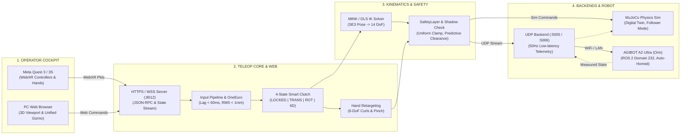

# AGIBOT A2 Ultra Teleoperation Thời Gian Thực qua Meta Quest 3 & Web Browser

Hệ thống điều khiển teleoperation song thủ độ trễ thấp và Digital Twin thời gian thực dành cho robot hình người **AGIBOT A2 Ultra** trang bị 2 bàn tay khéo léo 6 bậc tự do (6-DoF).

---

## 1. Cảnh Báo An Toàn & Tuyên Bố Bản Quyền
- **Nguyên tắc an toàn bất biến**: Mặc định chạy mô phỏng (MuJoCo). Kết nối tới phần cứng robot thật được bảo vệ nghiêm ngặt bằng token xác thực và cơ chế Auto-Homing chống giật.
- **Bản quyền kiến trúc**: Kế thừa kiến trúc nền tảng từ Unitree `xr_teleoperate` (Apache 2.0).
- **Trạng thái file lưới 3D**: Toàn bộ file lưới trực quan 3D trong [`assets/agibot_a2_ultra/`](file:///home/nguyen/a2_ws/assets/agibot_a2_ultra/) dùng cho mục đích nghiên cứu học thuật.

---

## 2. Kiến Trúc Hệ Thống & Luồng Dữ Liệu
Sơ đồ kiến trúc 4 phân tầng độc lập:



---

## 3. Cấu Trúc Thư Mục & Tổ Chức Mã Nguồn
- [`main.py`](file:///home/nguyen/a2_ws/main.py): Điểm khởi chạy ứng dụng hợp nhất (`UnifiedTeleopApp`).
- [`scripts/arm_teleop_rx.py`](file:///home/nguyen/a2_ws/scripts/arm_teleop_rx.py): Trình nhận lệnh UDP, auto-homing và điều khiển servo trên Orin robot.
- [`scripts/real_latency_ladder.py`](file:///home/nguyen/a2_ws/scripts/real_latency_ladder.py): Bộ công cụ đo kiểm thang độ trễ A/B/C/D bisect thời gian thực.
- [`scripts/analyze_ladder.py`](file:///home/nguyen/a2_ws/scripts/analyze_ladder.py): Phân tích ngoại tuyến log viễn giao và phân bố vận tốc khớp.
- [`teleop/robot/`](file:///home/nguyen/a2_ws/teleop/robot/): `UdpBackend`, `SafetyLayer`, `Ros2Backend`, `DryRunBackend`.
- [`teleop/kinematics/`](file:///home/nguyen/a2_ws/teleop/kinematics/): MINK/DLS IK, `RealLikeFollower`, bộ lọc OneEuro.
- [`teleop/web/`](file:///home/nguyen/a2_ws/teleop/web/): Máy chủ HTTPS/WSS, Three.js 3D Viewport, WebXR client.
- [`docs/`](file:///home/nguyen/a2_ws/docs/): Tài liệu hướng dẫn robot thật, thang đo độ trễ, và quy trình kiểm thử.

---

## 4. Cài Đặt Môi Trường
- **Hệ điều hành**: Ubuntu 22.04 LTS / 24.04 LTS.
- **Python**: Python 3.10+ virtualenv.
- **Cài đặt thư viện**:
```bash
cd ~/a2_ws
python3 -m venv venv
source venv/bin/activate
pip install -r requirements.txt
```

---

## 5. Hướng Dẫn Vận Hành

### A. Chế độ Mô phỏng (Simulation & WebXR)
```bash
# Mô phỏng đầy đủ có giao diện 3D MuJoCo:
python3 main.py --controller

# Chế độ điều khiển tay tự do (Hand tracking):
python3 main.py --input hands
```
Truy cập giao diện Web hoặc kính Quest tại: `https://<IP_LAPTOP>:8012`

### B. Vận hành Robot thật (Real Robot Hardware)
Xem hướng dẫn chi tiết từng bước tại [`real_robot_command.md`](file:///home/nguyen/a2_ws/real_robot_command.md).

1. **Đồng bộ script điều khiển sang Orin (chạy từ Terminal Laptop):**
   ```bash
   scp scripts/arm_teleop_rx.py agi@192.168.2.50:/agibot/data/home/agi/Desktop/mc/
   ```

2. **Khởi động Teleop Server trên Laptop:**
   ```bash
   cd ~/a2_ws
   source venv/bin/activate

   # Chế độ mượt mà như arm.py (khuyên dùng - mặc định ngắt mô phỏng MuJoCo & chạy headless):
   python3 main.py --backend real-udp --controller --real-max-vel 1.0 --i-understand-hardware-risk

   # Hoặc chế độ tốc độ cao:
   # python3 main.py --backend real-udp --controller --real-max-vel 1.8 --i-accept-higher-speed --i-understand-hardware-risk
   ```
   *(Khi chạy `--backend real-udp`, hệ thống tự động tắt hàm mô phỏng vật lý `env.step()`, ngắt nạp lệnh motor ảo MuJoCo và chạy headless để tiết kiệm tối đa CPU. Thêm cờ `--viewer` nếu bạn muốn mở cửa sổ giao diện desktop MuJoCo)*.

3. **Khởi động Node điều khiển trên Orin (SSH vào robot):**
   ```bash
   ssh agi@192.168.2.50
   # Mật khẩu: 1

   aima em load-env
   bash /agibot/data/home/agi/Desktop/motion_player/disable_motion_player.sh

   # Vào thư mục mc và kích hoạt Action (nếu cần thủ công):
   cd /agibot/data/home/agi/Desktop/mc
   python3 SetAction.py  # Chọn: McAction_RL_LOCOMOTION_ARM_EXT_JOINT_SERVO

   # Nạp cấu hình ROS 2:
   source /opt/ros/humble/setup.bash
   export ROS_DOMAIN_ID=232
   export ROS_LOCALHOST_ONLY=0
   export FASTRTPS_DEFAULT_PROFILES_FILE=/agibot/software/v0/entry/bin/cfg/ros_dds_configuration.xml

   # Chạy receiver:
   # Chế độ tiêu chuẩn (Profile normal: 0.3 rad/s - êm ru, đã kiểm định an toàn):
   python3 arm_teleop_rx.py --live --i-understand-hardware-risk --allow-ip 192.168.2.75 --port 5005 --speed-profile normal
   # Hoặc chế độ làm quen rất chậm (Profile slow: 0.2 rad/s):
   # python3 arm_teleop_rx.py --live --i-understand-hardware-risk --allow-ip 192.168.2.75 --port 5005 --speed-profile slow
   ```
   - **Bộ lọc dao động tắt dần bậc 2 (Critically Damped)**: Bounded acceleration ($\le 5\text{ rad/s}^2$), lọc phẳng hoàn toàn jitter mạng Wi-Fi giúp chuyển động lướt êm ru như `arm.py`.
   - **Tự động Auto-Homing**: Tự nội suy mượt S-curve từ tư thế hiện tại về vị trí HOME trong 2.5–5s.
   - **Tự động SetAction dự phòng**: Nếu chưa chạy `SetAction.py`, script cũng tự gọi RPC để chuyển Action 10 $\rightarrow$ 12.

---

## 6. Kiểm Thử & Đo Kiểm Độ Trễ
- **Chạy bộ kiểm thử chấp nhận (Acceptance Tests)**:
  ```bash
  python3 scripts/test_web_sync.py && python3 scripts/test_panel_api.py && python3 scripts/test_latency_ladder.py
  ```
  *(Hoặc chạy toàn diện qua `bash scripts/test_all.sh`)*.
- **Đo thang độ trễ robot thật (A/B/C/D Bisect)**:
  Xem hướng dẫn tại [`docs/LATENCY_LADDER.md`](file:///home/nguyen/a2_ws/docs/LATENCY_LADDER.md).
  ```bash
  python3 scripts/real_latency_ladder.py --host 192.168.2.50 --port 5005
  ```
- **Phân tích log telemetry**:
  ```bash
  python3 scripts/analyze_ladder.py logs/real_<timestamp>.jsonl
  ```
