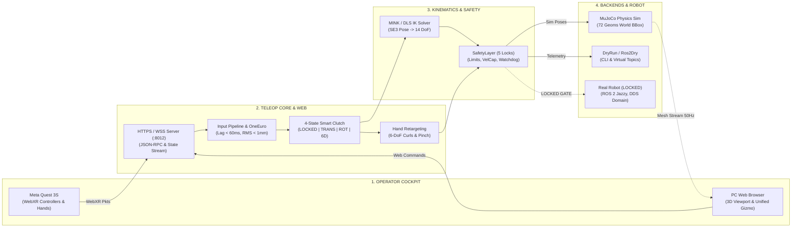

# AGIBOT A2 Ultra Teleoperation Thời Gian Thực qua Meta Quest 3S & Web Browser

Hệ thống điều khiển teleoperation song thủ độ trễ thấp và Digital Twin thời gian thực dành cho robot hình người AGIBOT A2 Ultra trang bị 2 bàn tay khéo léo 6 bậc tự do (6-DoF).

---

## 1. Cảnh Báo An Toàn & Tuyên Bố Bản Quyền
- **Nguyên tắc an toàn bất biến**: **MẶC ĐỊNH CHỈ CHẠY MÔ PHỎNG (MuJoCo)**. Kết nối tới phần cứng robot thật bị khóa sau 5 tầng cổng an toàn phần mềm độc lập. Chưa có tính năng nào được kiểm định trên robot thật; mọi thông số an toàn đều giả định phần cứng ở kịch bản rủi ro cao nhất.
- **Bản quyền kiến trúc**: Kế thừa kiến trúc nền tảng từ Unitree `xr_teleoperate` (Giấy phép Apache 2.0).
- **Trạng thái file lưới 3D**: Toàn bộ file lưới trực quan 3D trong [`assets/agibot_a2_ultra/`](file:///home/nguyen/a2_ws/assets/agibot_a2_ultra/) mang trạng thái **CHƯA XÁC NHẬN GIẤY PHÉP THƯƠNG MẠI** (được trích xuất từ nhà sản xuất cho mục đích nghiên cứu học thuật).

---

## 2. Kiến Trúc Hệ Thống & Luồng Dữ Liệu
Sơ đồ kiến trúc 4 phân tầng độc lập được biểu diễn chi tiết trong file [`docs/architecture.drawio`](file:///home/nguyen/a2_ws/docs/architecture.drawio):



---

## 3. Cấu Trúc Thư Mục & Tổ Chức Mã Nguồn
- [`main.py`](file:///home/nguyen/a2_ws/main.py): Điểm khởi chạy ứng dụng hợp nhất (`UnifiedTeleopApp`).
- [`scripts/run.sh`](file:///home/nguyen/a2_ws/scripts/run.sh): Trình khởi chạy dòng lệnh với các chế độ chuẩn hóa (`sim`, `controllers`, `hands`, `real`, `test`).
- [`teleop/app/`](file:///home/nguyen/a2_ws/teleop/app/): Vòng lặp điều khiển 200 Hz, máy trạng thái ly hợp 4 pha, giải mã WebXR.
- [`teleop/robot/`](file:///home/nguyen/a2_ws/teleop/robot/): `RobotInterface`, `SafetyLayer` (5 khóa an toàn), `Ros2Backend`, `DryRunBackend`.
- [`teleop/kinematics/`](file:///home/nguyen/a2_ws/teleop/kinematics/): Động học nghịch MINK và DLS, bộ lọc tín hiệu OneEuro.
- [`teleop/retargeting/`](file:///home/nguyen/a2_ws/teleop/retargeting/): Ánh xạ chuyển động tay và ngón tay robot AGIBOT A2 Ultra.
- [`teleop/simulation/`](file:///home/nguyen/a2_ws/teleop/simulation/): Mô phỏng vật lý MuJoCo, đồng bộ 72 visual geoms BBox.
- [`teleop/web/`](file:///home/nguyen/a2_ws/teleop/web/): Máy chủ HTTPS/WSS, Three.js 3D Viewport, module client WebXR.
- [`scripts/`](file:///home/nguyen/a2_ws/scripts/): Toàn bộ bộ kiểm thử tự động, tiền kiểm tra (preflight), và báo cáo.

---

## 4. Cài Đặt Môi Trường
- **Hệ điều hành**: Ubuntu 24.04 LTS (hoặc 22.04 LTS).
- **ROS 2**: ROS 2 Jazzy Jalisco (`/opt/ros/jazzy`).
- **Python**: 3.12 venv (sử dụng `--system-site-packages` để nhận diện `rclpy`).

```bash
cd ~/a2_ws
source /opt/ros/jazzy/setup.bash
python3 -m venv venv --system-site-packages
source venv/bin/activate
pip install -r requirements.txt
```

---

## 5. Bảng Lệnh Khởi Chạy Unified Launcher (`scripts/run.sh`)
Hệ thống sử dụng duy nhất một trình điều khiển với các lệnh chuẩn:

| Lệnh thực thi | Mục đích hoạt động | Di chuyển phần cứng? |
| :--- | :--- | :---: |
| `./scripts/run.sh sim` | Mô phỏng MuJoCo với 3D gizmo chuột trên trình duyệt | ❌ Không |
| `./scripts/run.sh controllers` | Điều khiển tay cầm kép Quest 3S WebXR trong mô phỏng | ❌ Không |
| `./scripts/run.sh hands` | Điều khiển bàn tay 1:1 tuyệt đối qua WebXR trong mô phỏng | ❌ Không |
| `./scripts/run.sh dryrun` | Chạy bộ điều khiển ảo xuất log đo lường dòng lệnh | ❌ Không |
| `./scripts/run.sh ros2dry` | Bật xuất bản ROS 2 ảo không kích hoạt động cơ | ❌ Không |
| `./scripts/run.sh replay <file>` | Phát lại quỹ đạo góc khớp đã ghi | ❌ Không |
| `./scripts/run.sh real` | Ủy quyền sang `scripts/run_real.sh` kèm tiền kiểm tra | ⚠️ **CÓ (NGUY HIỂM)** |
| `./scripts/run.sh test` | Chạy toàn bộ 8 bộ kịch bản kiểm thử tự động | ❌ Không |
| `./scripts/run.sh preflight` | Kiểm tra an toàn và kết nối trước khi khởi chạy | ❌ Không |
| `./scripts/run.sh report` | Tạo báo cáo nghiệm thu kiểm thử tự động | ❌ Không |
| `./scripts/run.sh help` | Hiển thị bảng tra cứu trợ giúp và thoát | ❌ Không |

> [!NOTE]
> Khi mở kính Meta Quest 3S, thiết lập cổng ADB qua cáp USB:
> `adb reverse tcp:8012 tcp:8012` rồi truy cập `https://localhost:8012/`.

---

## 6. Hướng Dẫn Vận Hành & Kiểm Thử Chi Tiết
- **Chi tiết từng chế độ vận hành & bảng phím tay cầm**: Xem tại [`docs/MODES.md`](file:///home/nguyen/a2_ws/docs/MODES.md).
- **Quy trình triển khai trên robot thật & 5 khóa an toàn**: Xem tại [`docs/REAL_ROBOT.md`](file:///home/nguyen/a2_ws/docs/REAL_ROBOT.md).
- **Hướng dẫn kiểm thử tự động & tiêu chí định lượng**: Xem tại [`docs/TESTING.md`](file:///home/nguyen/a2_ws/docs/TESTING.md).
- **Khắc phục sự cố, điểm chưa xác định & quy tắc Git**: Xem tại [`docs/TROUBLESHOOTING.md`](file:///home/nguyen/a2_ws/docs/TROUBLESHOOTING.md).
