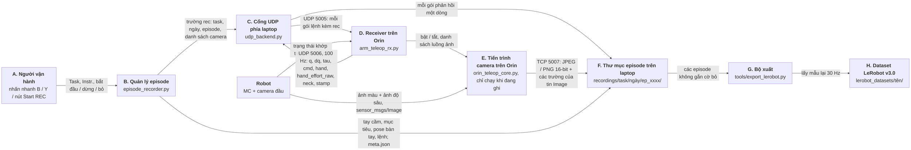

# AGIBOT A2 Ultra Teleoperation Thời Gian Thực qua Meta Quest 3 & Web Browser

Hệ thống điều khiển teleoperation song thủ độ trễ thấp và Digital Twin thời gian thực dành cho robot hình người **AGIBOT A2 Ultra** trang bị 2 bàn tay khéo léo 6 bậc tự do (6-DoF).

---

## 1. Kiến Trúc Hệ Thống & Luồng Dữ Liệu

### 1.1 Luồng điều khiển (teleop)

Dữ liệu đi từ trái sang phải; nhãn trên mũi tên là thứ được truyền đi. Đường nét đứt là chiều phản hồi. Sơ đồ được vẽ ở kích thước thật (không co cho vừa khung), nên hãy cuộn ngang để xem hết.

```mermaid
%%{init: {"flowchart": {"useMaxWidth": false, "nodeSpacing": 45, "rankSpacing": 90}, "themeVariables": {"fontSize": "24px"}}}%%
flowchart LR
    QUEST["<b>1. Quest - trang WebXR</b><br/>webxr_controllers.js<br/>~72-90 Hz"]
    WEB["<b>2. Máy chủ web</b><br/>teleop/web/server, cổng 8012"]
    INPUT["<b>3. Xử lý nút</b><br/>xr_input_handler.py"]
    CLUTCH["<b>4. Ly hợp tay cầm</b><br/>xr_clutch_mapper.py"]
    HANDR["<b>5. Bàn tay</b><br/>agibot_hand_retargeting.py"]
    IK["<b>6. IK</b><br/>ik_dispatcher.py + mink_ik.py"]
    LIM["<b>7. Bộ giới hạn khớp</b><br/>mirror_limiter.py, 100 Hz"]
    UDP["<b>8. Cổng UDP phía laptop</b><br/>udp_backend.py"]
    PACER["<b>9. Pacer trên Orin</b><br/>orin_teleop_core.py, 400 Hz"]
    RX["<b>10. Receiver trên Orin</b><br/>arm_teleop_rx.py"]
    MC["<b>11. Bộ điều khiển khớp MC</b><br/>của robot"]
    TWIN["<b>12. Digital twin + telemetry</b><br/>MuJoCo, telemetry_builder.py"]

    QUEST -->|"pose 2 tay cầm, Trigger, Grip, cần gạt, nút"| WEB
    WEB -->|"gói xr_controllers"| INPUT
    INPUT -->|"pose + Trigger/Grip"| CLUTCH
    INPUT -->|"độ đóng bàn tay, kiểu nắm"| HANDR
    CLUTCH -->|"mục tiêu bàn tay: vị trí 3 + hướng 3x3, mỗi tay"| IK
    IK -->|"góc khớp mục tiêu, 14"| LIM
    LIM -->|"góc khớp đã giới hạn, 14"| UDP
    HANDR -->|"lệnh ngón, 12"| UDP
    UDP -->|"UDP 5005, 100 Hz: seq, q 14, hand 12, engaged, rec"| PACER
    PACER -->|"chuyển tiếp từng gói"| RX
    RX -.->|"chế độ: im / giữ / bám; điểm đồng bộ lúc engage"| PACER
    PACER -->|"arm_joint_command: vị trí 14 khớp, 400 Hz"| MC
    RX -->|"hand_joint_command: vị trí 12 ngón, 100 Hz"| MC
    MC -.->|"arm / hand / neck joint_state, 100 Hz"| RX
    RX -.->|"UDP 5006, 100 Hz: q 14, hand 12, rx_state, lỗi"| UDP
    UDP -.->|"khớp đo được"| TWIN
    TWIN -.->|"trạng thái + pose 3D qua WebSocket"| WEB
    WEB -.->|"hiển thị trong kính và trên PC"| QUEST
```



| # | Module | File | Đầu vào | Đầu ra |
| :-- | :--- | :--- | :--- | :--- |
| 1 | Trang WebXR trong Quest | `teleop/web/static/js/webxr_controllers.js` | Pose và nút của hai tay cầm từ kính (~72-90 Hz) | Gói `xr_controllers` qua WebSocket: mỗi tay `pos` (3), `quat` wxyz (4), `trigger`, `grip`, `thumbstick`, các nút |
| 2 | Máy chủ web | `teleop/web/server/` | Gói từ Quest, lệnh từ bảng web (`/api/command`, `/ws_panel`) | Lệnh cho ứng dụng; đẩy trạng thái và pose 3D về trình duyệt |
| 3 | Xử lý nút | `teleop/app/xr_input_handler.py` | Gói `xr_controllers` | Hành động nút (HOME, REC), độ đóng bàn tay; chuyển pose cho ly hợp |
| 4 | Ly hợp tay cầm | `teleop/app/xr_clutch_mapper.py` | Pose tay cầm, Trigger/Grip, scale, khóa trục | Mục tiêu bàn tay robot trong hệ tọa độ thân robot: vị trí (3, m) + ma trận hướng (3×3), mỗi tay |
| 5 | Bàn tay | `teleop/retargeting/agibot_hand_retargeting.py` | Độ đóng (0-1) và kiểu nắm, mỗi tay | Góc 6 khớp ngón mỗi tay (12) |
| 6 | IK | `teleop/app/ik_dispatcher.py`, `teleop/kinematics/mink_ik.py` | Mục tiêu bàn tay; tư thế hiện tại | Góc khớp mục tiêu của hai tay (14, rad), sau khi lọc mục tiêu, chiếu vào tầm với và chống va chạm |
| 7 | Bộ giới hạn khớp | `teleop/kinematics/mirror_limiter.py` | Góc khớp mục tiêu (14), mức `--speed`, `--smooth` | Góc khớp đã giới hạn tốc độ và gia tốc (14, rad), 100 Hz |
| 8 | Cổng UDP phía laptop | `teleop/robot/udp_backend.py` | Góc khớp (14), lệnh ngón (12), trạng thái engage, yêu cầu ghi dữ liệu | Gói JSON tới Orin, UDP 5005, 100 Hz: `seq`, `t`, `session_id`, `q` (14), `hand` (12, giá trị thô), `engaged` (2), `rec`. Nhận gói phản hồi UDP 5006 |
| 9 | Pacer | `scripts/orin_teleop_core.py` (`pacer_main`) | Gói UDP từ laptop; chế độ từ receiver | `/motion/control/arm_joint_command` (`sensor_msgs/JointState`: 14 tên khớp, `position`, `velocity`), mặc định 400 Hz; chuyển tiếp gói cho receiver |
| 10 | Receiver | `scripts/arm_teleop_rx.py` | Gói do pacer chuyển tiếp; `/motion/control/arm_joint_state`, `hand_joint_state`, `neck_joint_state` | Chế độ cho pacer (im / giữ / bám); `/motion/control/hand_joint_command` (12 ngón); gói phản hồi về laptop UDP 5006, 100 Hz: `q` (14), `hand` (12), `rx_state`, `robot_fault` |
| 11 | Bộ điều khiển khớp (MC) | của hãng | Lệnh khớp tay và ngón | Chuyển động robot; các topic trạng thái khớp (100 Hz) |
| 12 | Digital twin + telemetry | `teleop/simulation/`, `teleop/app/telemetry_builder.py` | Khớp đo được từ gói phản hồi | Mô hình 3D theo robot thật; trạng thái hiển thị trên web và trong kính |

Thông số mặc định của từng khâu: tay cầm → robot 1:1, tự giảm dần từ 80% tầm với trở ra (khâu 4); khóa trục bật (khâu 4); kéo nhẹ vai và khuỷu về tư thế nghỉ HOME, ưu tiên khuỷu mở ra ngoài khi nó ở gần thân hơn 15 cm, và với chuột / nút dịch thì giữ cổ tay thẳng (khâu 6); trần 2.0 rad/s, 6.28 rad/s² ở speed 6 (mặc định từ 17/11), làm mượt mức 1, các khớp của một tay chậm lại cùng tỉ lệ để bàn tay đi thẳng (khâu 7); pacer phát 400 Hz, nhanh hơn chu kỳ 100 Hz của MC, làm tay robot bớt rung rõ rệt (đo trên robot thật 13/11) (khâu 9).

### 1.2 Luồng thu dữ liệu và xuất LeRobot



| # | Module | File | Đầu vào | Đầu ra |
| :-- | :--- | :--- | :--- | :--- |
| A | Người vận hành | tay cầm, thẻ **Data Recording** | Nhấn nhanh **B** / **Y** (bắt đầu/dừng), nút **Discard last** và ô **Discard reason** (gắn cờ bỏ), ô **Task** và **Instr.** | Lệnh `rec_start` / `rec_stop` / `rec_discard` |
| B | Quản lý episode | `teleop/app/episode_recorder.py` | Lệnh ghi; trạng thái teleop mỗi vòng lặp | Tạo thư mục episode, `meta.json`; ghi `teleop.jsonl` (tới 100 Hz); trường `rec` cho gói lệnh |
| C | Cổng UDP phía laptop | `teleop/robot/udp_backend.py` | Trường `rec`; gói phản hồi từ Orin | Gói lệnh kèm `rec` (UDP 5005); mỗi gói phản hồi thành một dòng `robot.jsonl` kèm giờ nhận |
| D | Receiver trên Orin | `scripts/arm_teleop_rx.py` | Gói lệnh có `rec`; `arm_joint_state`, `hand_joint_state`, `neck_joint_state` | Khi có `rec`, gói phản hồi 100 Hz thêm: `stamp` (dấu thời gian MC), `dq` (14), `tau` (14), `cmd` (14), `hand_tau`, `hand_effort_raw`, `hand_type`, `neck` (2). Bật/tắt tiến trình camera |
| E | Tiến trình camera | `scripts/orin_teleop_core.py` (`camera_main`) | `/aima/hal/rgbd_camera/head_front/color` và `.../depth` (`sensor_msgs/Image`) | Qua TCP 5007, mỗi khung: tiêu đề JSON (stamp, frame_id, height, width, encoding, is_bigendian, step, kích thước đã lưu) + ảnh màu JPEG (q85) hoặc ảnh độ sâu PNG 16-bit, cỡ gốc 1280×720 từ 17/11 (`REC_CAM_WIDTH` / `REC_DEPTH_WIDTH`; `640` = như trước 17/11); tối đa 15 Hz |
| F | Thư mục episode | `recordings/<task>/<ngày>/ep_<số>_<giờ>/` | Ba luồng trên | `meta.json`, `robot.jsonl`, `teleop.jsonl`, `images.jsonl`, `images/head/*.jpg`, `images/head_depth/*.png` |
| G | Bộ xuất | `tools/export_lerobot.py` (chạy bằng `venv_lerobot`) | Các thư mục episode (bỏ qua episode gắn cờ bỏ) | Khung 30 Hz: `observation.state` (62: khớp tay 14 + ngón 12 + pose hai bàn tay robot 18 + pose hai tay cầm 18, hướng dạng xoay 6D), `action` (26), `action.ee_pose` (16), `observation.ee_pose` (14), tùy dữ liệu có: `observation.velocity`, `observation.effort`, `observation.neck`, `observation.hand_effort_raw`, `observation.images.head`, `observation.images.head_depth`; `task` = câu lệnh |
| H | Dataset | `lerobot_datasets/<tên>/` | Kết quả của bộ xuất | LeRobot v3.0: `meta/info.json`, `meta/stats.json`, `meta/tasks.parquet`, `meta/episodes/`, `data/chunk-000/*.parquet`, `videos/<camera>/chunk-000/*.mp4` |

Orin tự ngừng gửi dữ liệu ghi nếu laptop im lặng 3 giây. Chi tiết từng trường trong các file và từng cột dataset: mục 3.

---

## 2. Cấu Trúc, Cài Đặt, Vận Hành & Điều Khiển

### 2.1 Cấu Trúc Thư Mục & Tổ Chức Mã Nguồn
- [`main.py`](main.py): điểm khởi chạy (`UnifiedTeleopApp`).
- [`teleop/app/`](teleop/app/): vòng điều khiển, ly hợp tay cầm (`xr_clutch_mapper.py`), xử lý nút (`xr_input_handler.py`), điều phối IK (`ik_dispatcher.py`), máy trạng thái SYNC/READY/ENGAGED (`sync_manager.py`), thu dữ liệu (`episode_recorder.py`).
- [`teleop/kinematics/`](teleop/kinematics/): IK `mink_ik.py`, bộ giới hạn khớp `mirror_limiter.py`, chiếu tầm với `reach_projection.py`.
- [`teleop/robot/`](teleop/robot/): `UdpBackend` (gửi lệnh, nhận phản hồi), `SafetyLayer`, ghi trace.
- [`teleop/web/`](teleop/web/): máy chủ HTTPS/WSS, giao diện Three.js, WebXR.
- [`scripts/`](scripts/): chỉ các file dùng trong `real_robot_command.md` / `sim_command.md`: receiver chép lên Orin (`arm_teleop_rx.py`, `orin_teleop_core.py` chứa pacer, tiến trình camera và bộ ghi tùy chọn, `orin_trace_logger.py`, `async_writer.py`), `test_sil.py`, `plant_excitation.py`, `classify_arrival.py`, và 2 test chấp nhận `test_web_sync.py`, `test_panel_api.py`.
- [`tests/`](tests/): test hồi quy còn lại (`bash tests/test_all.sh`).
- [`tools/`](tools/): `export_lerobot.py` (xuất dataset), `check_episode.py` (lọc episode xấu), `filter_report.py` (so sánh bộ lọc trên quỹ đạo thật), `vibration_report.py` (đo rung từ trace trên Orin), `arm_stream_test.py` (thử phát lệnh trực tiếp trên Orin), `stream_test_report.py` (đọc log của `arm_stream_test`), `view_episode.py` (xem episode: video camera + biểu đồ khớp), `data_status.py` (liệt kê tập thô, bộ LeRobot, tập nào đã xuất), `joint_limit_sweep.py` + `joint_sweep_report.py` (quét từng khớp trên Orin → độ rung bàn tay mm → đề xuất `JOINT_VMAX` / `JOINT_AMAX`), `pull_episodes.sh`, công cụ đo đạc và phân tích log.
- [`sil/`](sil/): A2SIM / SIL (Orin giả, MC giả, camera giả), xem [`docs/SIL.md`](docs/SIL.md).
- `recordings/`, `lerobot_datasets/`, `logs/`, `venv/`, `venv_lerobot/`: sinh ra khi chạy, không đưa lên git.
- [`docs/`](docs/): thông số robot, SIL, đo độ trễ, xử lý sự cố.

### 2.2 Cài Đặt Môi Trường
- **Hệ điều hành**: Ubuntu 22.04 LTS / 24.04 LTS. **Python** 3.12 cho teleop (venv tạo bằng `uv`); ROS 2 Humble của hệ thống (Python 3.10) chỉ cần cho SIL.
- **Môi trường teleop**:
```bash
cd ~/a2_ws
uv venv --python 3.12 venv
uv pip install --python venv/bin/python -r requirements.txt
source venv/bin/activate
```
- **Môi trường xuất LeRobot** (riêng, khoảng 5.6 GB vì có torch; chỉ cần khi xuất dataset):
```bash
uv venv --python 3.12 venv_lerobot
uv pip install --python venv_lerobot/bin/python "lerobot[dataset-viz]==0.7.0"
```
- Truy cập `localhost` phải bỏ qua proxy: `export no_proxy=localhost,127.0.0.1`.

### 2.3 Hướng Dẫn Vận Hành

#### A. Mô phỏng
```bash
cd ~/a2_ws && source venv/bin/activate
python main.py --sim            # tự mở cửa sổ MuJoCo; --no-viewer để tắt
```
Mở `https://localhost:8012` trên PC, hoặc trong kính Quest.

**Kịch bản tập gắp vật vào thùng** (17/11): `python main.py --sim --scene pick_bin` (mô phỏng), hoặc `python main.py --scene pick_bin` với robot thật: khi đó bàn / thùng / vật là **ảo**, hiện quanh mô hình robot trên 8012 và Quest, vật bám theo bàn tay được lệnh, không có vật thật nào bị tác động.
- **Bố trí:** bàn cao 0,78 m trước robot, 4 vật (khối đỏ, lon xanh, thanh vàng, khối tím) ở phía trước bên phải, thùng xanh ở giữa phía trước. Tay A2 chỉ với khoảng 0,5 m tính từ vai, nên bàn thấp hơn sẽ ngoài tầm.
- **Gắp:** đưa bàn tay tới vật, nắm (≥ 45 %) để nhặt, mang tới trên thùng, mở tay (≤ 30 %) để thả. Đây là gắp *hỗ trợ*: vật dính theo bàn tay chứ không mô phỏng ma sát; tay robot không va chạm vật lý.
- **Hiển thị:** thấy trên trang `https://<máy>:8012` và trong kính Quest (ENTER VR), cũng như cửa sổ MuJoCo (tự mở khi chạy `--sim`; với robot thật thêm `--viewer`). Di chuột lên nhãn `LIVE (MUJOCO)` để xem số vật đã vào thùng.
- **Theo dõi và đặt lại:** terminal in `[TASK] right hand picked ...` / `released ...`; nút Reset đặt vật về chỗ cũ.

Hướng dẫn đầy đủ (gồm A2SIM, giả lập cả Orin): [`sim_command.md`](sim_command.md).

#### B. Robot thật
Làm theo từng bước trong [`real_robot_command.md`](real_robot_command.md); tóm tắt:

1. **Chép receiver lên Orin** khi code đổi (đối chiếu mã băm ghi trong hướng dẫn):
   ```bash
   scp scripts/arm_teleop_rx.py scripts/orin_teleop_core.py scripts/orin_trace_logger.py scripts/async_writer.py agi@192.168.2.50:/agibot/data/home/agi/Desktop/mc/
   ```
2. **Orin** (SSH `agi@192.168.2.50`): nạp môi trường, tắt motion player, `python SetAction.py` chọn **10** (chờ đứng vững) rồi **12**, rồi `sudo prlimit --pid $$ --rtprio=30:30 --nice=40:40` (cho pacer chạy real-time, thiếu bước này tay giật) và `python arm_teleop_rx.py`. Receiver phải in `[pacer] arm command pacer running: 400 Hz ... SCHED_FIFO 30 (real-time)`.
3. **Laptop**: `python main.py`. Mặc định: robot thật, speed 6, `--smooth 1`, luật `direct`, khóa trục bật, scale 1:1, khuỷu ưu tiên mở ra ngoài (`--elbow-out 15`), ngón tay nắm hết hành trình, ngón cái nghỉ ở tư thế cầm vật, đóng/mở theo cần gạt (`--thumb-pose 400,900,800,1500`).
4. **Quest**: mở `https://192.168.2.75:8012`, bấm **ENTER VR**, chờ trạng thái tự lên `ENGAGED`.

Tùy chọn hay dùng của `main.py`:

| Cờ | Ý nghĩa |
| :--- | :--- |
| `--sim` | Chạy mô phỏng thay vì robot thật |
| `--speed 1..6` | Trần tốc độ / gia tốc khớp: 1 = 0.4 rad/s, 1.0 rad/s²; 2 = 0.6, 1.5; 3 = 0.8, 2.0; 4 = 1.0, 2.5; 5 = 1.5, 4.0; 6 = 2.0, 6.28. Mặc định 6 từ 17/11 (bám 1:1 trước); mức thấp êm hơn nhưng trễ hơn, mức 3 êm nhất đã thử. Receiver phải chạy cùng mức. Rung của tay robot tỉ lệ với tốc độ khớp |
| `--hand-raw-max 0..2000` | Trần hành trình ngón tay (mặc định 2000 = nắm hết; trước 13/11 là 800 = 40%); receiver có cùng tham số |
| `--scene pick_bin` | cảnh tập gắp vật vào thùng (với `--sim`, hoặc ảo quanh mô hình khi chạy robot thật): bàn, 4 vật, thùng; hiện trên web 8012, Quest và cửa sổ MuJoCo |
| `--thumb-pose S,F[,S2,F2]` | Ngón cái **nghỉ** ở tư thế cầm vật và **đóng/mở theo cần gạt** cùng 4 ngón. Mặc định `400,900,800,1500`: tay mở = xoay 400 / gập 900, nắm hết = xoay 800 / gập 1500 (17/11: xoay 1200 → 800 vì ngón cái chạm ngón trỏ; tối 17/11 xoay lúc mở → 400 và lực giữ ngón cái 2280 (`THUMB_EFFORT`, receiver) để ngón cái bớt lắc khi vung tay; muốn dang ra thêm: `600,900,600,1500`, gần lại: `1000,900,1000,1500`) (không chắn ngón trỏ / giữa). 2 số = chỉ tư thế mở. Receiver giữ tư thế mở cả khi chưa engage (`--thumb-pose 400,900`). `off` = ngón cái theo tay từ duỗi thẳng như cũ |
| `--thumb-rest 0..2000` | Chỉ có tác dụng với `--thumb-pose off`: tư thế nghỉ của hai khớp ngón cái khi tay mở (mặc định 500 = gập nhẹ 25%; 0 = duỗi thẳng); receiver có cùng tham số |
| `--elbow-out 0..20` | Ưu tiên khuỷu tay mở ra ngoài: kéo khuỷu ra phía ngoài khi nó ở gần thân hơn chừng này cm tính từ vai (mặc định 15; 9 = không đụng tới tư thế kiểu HOME; 0 = tắt). Sau khi ngừng kéo chuột / nhả trigger, IK còn chạy tiếp tối đa 3 s để khuỷu xoay xong (bàn tay giữ nguyên; `IK_SETTLE_S=0` tắt) |
| `--smooth 0..3` | Mức làm mượt lệnh (mặc định 1 từ 17/11: gia tốc 6.0, đáp ứng 0.04 s, lọc đầu ra 4 tick, không lọc thứ hai; 2 = 4.0 / 0.06 s / 8 tick + lọc thứ hai 10; 3 = 3.0 / 0.10 s / 6 + 4 tick, êm hơn nhưng trễ hơn; 0 = tắt) |
| `--no-axis-lock` | Tắt khóa trục mềm: tay cầm luôn đi tự do 3D |
| `--xr-scale 0.6` | Tỉ lệ tay cầm → robot lúc khởi động (mặc định 1.0); đổi khi đang chạy bằng thanh **Controller → Robot Scale** trên bảng web |
| `--limiter brake` | Luật giới hạn cũ: phanh êm nhưng trễ 0.4-0.8 s |

Công tắc bằng biến môi trường phía laptop (đặt trước lệnh, ví dụ `XR_COAST=0 python main.py`); mặc định BẬT, trừ `DIRECT_OUT_FIR2` (tắt ở `--smooth 1` mặc định):

| Biến | Tắt bằng | Khi bật (mặc định) |
| :--- | :--- | :--- |
| `NUDGE_GLIDE` | `NUDGE_GLIDE=0` | Nút dịch XYZ / xoay: đích trượt mượt tới vị trí mới, IK chạy mỗi nhịp tới khi tay đứng yên (tắt = nhảy từng bước như cũ) |
| `SOFT_ORI` | `SOFT_ORI=0` | Kéo chuột tịnh tiến / nút dịch XYZ: bàn tay xoay theo cẳng tay để cổ tay giữ thẳng (tắt = giữ cứng hướng bàn tay, cho cả chuột lẫn tay cầm) |
| `IK_SETTLE_S` | `IK_SETTLE_S=0` | Sau khi ngừng điều khiển, IK chạy tiếp tối đa 3 s để khuỷu xoay xong; bàn tay giữ nguyên vị trí |
| `DIRECT_OUT_FIR2` | `DIRECT_OUT_FIR2=1` | Phanh tăng dần và giảm dần (lọc đầu ra thứ hai: tắt ở `--smooth 1`, 10 nhịp ở `--smooth 2`, 4 nhịp ở `--smooth 3` từ 17/11; bật thủ công vd `DIRECT_OUT_FIR2=4`; bản cũ `DIRECT_OUT_FIR=12` + 10 mượt hơn nhưng trễ thêm ~60 ms): tốc độ tối đa giữ nguyên, lực phanh không bật / tắt đột ngột nên bàn tay bớt lắc khi dừng; mỗi lần dừng xong muộn hơn khoảng 25 ms |
| `XR_SOFT_ORI` | `XR_SOFT_ORI=0` | Tay cầm, chỉ giữ trigger (tịnh tiến): hai khớp cổ tay giữ nguyên góc, bàn tay xoay theo cẳng tay. Giữ thêm grip (xoay / 6D) thì hướng bàn tay được giữ đúng như cũ |
| `HAND_HOLD_MOVING` | `HAND_HOLD_MOVING=0` | Ngón tay giữ nguyên lệnh khi cánh tay đó đang chạy nhanh hơn 0.15 rad/s; lệnh nắm / mở đang chờ được áp dụng khi tay chậm lại |
| `HOME_MAX_VEL` | `HOME_MAX_VEL=2.0` | Nút Home và các preset đi tối đa 0.8 rad/s (bằng mức 3) dù `--speed` cao hơn, để bàn tay ít rung trên đường về; điều khiển bằng tay cầm / chuột vẫn theo `--speed` |
| `XR_COAST` | `XR_COAST=0` | Nhả trigger khi robot còn đang đuổi theo: bàn tay đi tiếp theo đường thẳng tới đích thay vì đích IK nhảy một bước |

Khi nghi một thay đổi phía laptop gây giật, tắt hết để so sánh: `DIRECT_OUT_FIR2=1 XR_SOFT_ORI=0 HAND_HOLD_MOVING=0 SOFT_ORI=0 IK_SETTLE_S=0 XR_COAST=0 NUDGE_GLIDE=0 python main.py --elbow-out 0`, rồi bật lại từng cái.

Receiver trên Orin (`python arm_teleop_rx.py`, sau `sudo prlimit --pid $$ --rtprio=30:30 --nice=40:40`) mặc định: `--speed 6`, phát lệnh 400 Hz (pacer real-time SCHED_FIFO 30), bộ đệm khử jitter 30 ms, lọc thông thấp TẮT (từ 17/11; xem [docs/FILTER_REPORT.md](docs/FILTER_REPORT.md)), lệnh gồm vị trí + vận tốc, `--hand-raw-max 2000`, `--thumb-pose 400,900`, `THUMB_EFFORT=2280` (lực giữ ngón cái), `--thumb-rest 500`. Nếu tiến trình receiver im quá 0.5 s, pacer GIỮ tay (in `[pacer] parent silent ... -> HOLD arm`, rồi `resumed`); pacer chỉ thoát sau 3 s im lặng hoặc khi receiver chết, luôn in `[pacer] stopped: <lý do>`. Tùy chọn bằng biến môi trường: `PACER_HZ=200` hoặc `PACER_HZ=100` (về tần số phát cũ, rung nhiều hơn), `PACER_SMOOTH_MS` (lọc thông thấp từng khớp theo khuyến nghị của hãng; mặc định 0 = tắt; 60 = hai tầng 60 ms, trễ thêm khoảng 120 ms), `PACER_FILTER=kalman` (Kalman vận tốc không đổi; `KALMAN_Q`, `KALMAN_R`, `KALMAN_LPF_MS`) hoặc `PACER_FILTER=oneeuro` (lọc thích nghi theo tốc độ) thay cho lọc thông thấp, `PACER_MAX_ACC=6.28` (giới hạn gia tốc; mặc định tắt vì làm tay đung đưa khi dừng), `PLAYOUT_MS` (độ dài bộ đệm khử jitter, mặc định 30), `JOINT_VMAX` / `JOINT_AMAX` / `JOINT_TAU_MS` (giới hạn tốc độ / gia tốc / làm mượt riêng từng khớp, 1, 7 hoặc 14 số; **mặc định cấu hình D từ 17/11**: `JOINT_VMAX=1.2,1.5,1.2,1.5,2,2,2 JOINT_AMAX=6`, `off` để tắt; cấu hình D trong `real_robot_command.md`), `ORIN_PACER=0` (tắt pacer), `ARM_CMD_FORMAT=vendor` (trường velocity / effort = 0 như ví dụ của hãng). Phân tích nguyên nhân rung và so sánh bộ lọc: [docs/FILTER_REPORT.md](docs/FILTER_REPORT.md). So sánh các bộ lọc trên một quỹ đạo thật: `python tools/filter_report.py logs/trace_laptop_<giờ>.jsonl` (bảng + ảnh; `--raw` phát lại đầu ra IK, cấu hình `joint-k1` / `joint-k3` / `joint-k2` / `acc8`).

An toàn từ 17/11: mỗi bản tin lệnh khớp đổi ≤ 0.018 rad và tốc độ ≤ giới hạn (≤ 3 rad/s) kể cả khi bị ép vào giới hạn khớp; lúc engage giới hạn được nới để bao tư thế robot đang đứng (robot không tự di chuyển). Laptop báo `JOINT NOT FOLLOWING: <tay> J<k>` khi một khớp lệch lệnh > 0.35 rad quá 1 s (MC không còn điều khiển khớp đó: dừng, tắt / bật nguồn robot; chi tiết `real_robot_command.md` mục SỰ CỐ KHUỶU 17/11).

### 2.4 Cấu Hình Nút Tay Cầm Quest

Bảng dưới là cấu hình đang chạy trong code (`teleop/app/xr_input_handler.py`, `teleop/app/xr_clutch_mapper.py`, `teleop/web/static/js/webxr_controllers.js`). Hai tay cầm đối xứng: tay cầm trái điều khiển tay robot trái, tay cầm phải điều khiển tay robot phải.

| Nút | Tay cầm trái | Tay cầm phải |
| :--- | :--- | :--- |
| **Trigger** (ngón trỏ), giữ | Tịnh tiến tay robot trái theo tay cầm; cổ tay giữ thẳng nên bàn tay nghiêng theo cẳng tay (muốn giữ đúng hướng bàn tay: giữ thêm Grip, hoặc chạy `XR_SOFT_ORI=0`) | Tịnh tiến tay robot phải (cùng quy tắc) |
| **Grip** (cạnh hông), giữ | Xoay cổ tay robot trái | Xoay cổ tay robot phải |
| **Trigger + Grip**, giữ | Vừa tịnh tiến vừa xoay (6D) | Vừa tịnh tiến vừa xoay (6D) |
| **Cần gạt** đẩy lên / kéo xuống | Đóng / mở bàn tay trái | Đóng / mở bàn tay phải |
| **Cần gạt trái / phải** | Đổi kiểu nắm bàn tay trái | Đổi kiểu nắm bàn tay phải |
| **Bấm cần gạt** | Mở bàn tay trái ngay (panic open) | Mở bàn tay phải ngay |
| **X** / **A**, nhấn | Tay trái về HOME ngay | **Cả hai tay** về HOME ngay (không cần giữ) |
| **Y** / **B**, nhấn nhanh (< 0.5 s) | Bắt đầu / dừng record episode | Bắt đầu / dừng record episode (cùng chức năng với tay trái) |
| **Bấm cả hai cần gạt**, giữ 0.5 s | Bật/tắt chế độ chỉnh góc nhìn trong kính (khi bật: cần gạt phải xoay/zoom, cần gạt trái nâng/hạ, A đặt lại góc nhìn; trong chế độ này mọi nút bị chặn nên A không đưa tay về HOME) | |

Mặc định: khóa trục mềm bật (đưa tay thật thẳng theo một trục ±X/±Y/±Z, lệch dưới 12°, thì tay robot đi theo trục đó, phần lệch trục vẫn đi 30 %, nhả khóa khi lệch quá 20°; tay chậm quá 0,25 s hoặc đưa chéo thì đi tự do 3D theo tay; xoay cũng vậy), tỉ lệ tay cầm → robot 1:1 (đổi bằng thanh **Controller → Robot Scale** trên bảng web), gần biên tầm với tỉ lệ tự giảm dần.

---

## 3. Thu Dữ Liệu & Xuất LeRobot

**Tài liệu đầy đủ về thu dữ liệu, xử lý, xuất và xem: [`DATA_COLLECTION.md`](DATA_COLLECTION.md).** Mục này là bản tóm tắt.

Luồng và các module: mục 1.2. Mục này gồm toàn bộ phần vận hành: thao tác ghi, cấu trúc dữ liệu một episode, ảnh camera, xuất sang LeRobot và đầu vào / đầu ra khi train.

**Bản đồ lưu trữ: data nằm ở đâu (tất cả trên laptop, trong thư mục dự án `~/a2_ws`)**

> Đổi tên 17/11 cho dễ hiểu: `data/` → **`recordings/`** (bản thô), `datasets/` → **`lerobot_datasets/`** (bộ LeRobot). Dữ liệu cũ đã được chuyển; bộ đã xuất vẫn đọc được.

```
~/a2_ws/
├── recordings/                    ← KHO 1: BẢN THÔ (bạn nhấn B là sinh ra)
│   └── <task>/<ngày>/ep_<số>_<giờ>/    mỗi lần nhấn B = một thư mục: meta.json, robot.jsonl, teleop.jsonl, images/
├── lerobot_datasets/              ← KHO 2: BỘ LEROBOT (tự sinh từ kho 1, để train)
│   └── <task>/                         data/ (parquet) · videos/ (mp4) · meta/ (info.json, a2_sources.json...)
└── logs/                          ← log kỹ thuật của từng phiên main.py (không phải data train)
```

Đi một chiều: **robot + tay cầm → `recordings/` (bản thô) → tự động → `lerobot_datasets/<task>` (bản LeRobot) → train**. Chỉ cần nhớ ba điều:
1. **`recordings/` là gốc, `lerobot_datasets/` là bản dẫn xuất.** `lerobot_datasets/` mất thì xuất lại được từ `recordings/`; `recordings/` mất thì mất hẳn. Sao lưu `recordings/` (copy cả thư mục).
2. **Tên bộ LeRobot = tên Task** bạn điền trên thẻ Data Recording. Mỗi Task một bộ: `pick_cup` → `lerobot_datasets/pick_cup`. Muốn tách bộ thì đổi Task trước khi ghi.
3. **Mỗi lần nhấn B xong, không cần làm gì thêm**: ~10 s sau tập tự được thêm vào bộ.

**Xem tổng quan bằng một lệnh** (có bao nhiêu tập, tập nào tốt / hỏng / đã bỏ, đã vào bộ nào, dung lượng, tập nào chưa xuất):

```bash
cd ~/a2_ws && venv/bin/python tools/data_status.py            # thêm --task pick_cup, hoặc --quick cho nhanh
```
```
  pick_cup / 2026-11-17
    ep_0001_101532   25 s  OK     58 MB  "pick up the cup"  -> lerobot_datasets/pick_cup #0
    ep_0002_101801   18 s  BỎ (dropped_object)               (không xuất vì đã bỏ)
DATASETS
  lerobot_datasets/pick_cup      1 tập, 694 khung, 30 fps, 61 MB, camera: head, head_depth
```
Dòng `NOT EXPORTED` cho biết tập nào chưa được xuất và lý do.

**Quy trình xử lý data (từ 17/11, không cần chạy script):**

| Bước | Làm gì | Ở đâu / kết quả |
| :--- | :--- | :--- |
| 1. Đặt tên | Thẻ **Data Recording** trên panel: **Task** (vd `pick_cup`), **Instr.** (câu lệnh cho VLA) | — |
| 2. Ghi | Nhấn nhanh **B** (hoặc Y) để bắt đầu, nhấn lần nữa để dừng | Laptop: `recordings/<task>/<ngày>/ep_<n>_<giờ>/` |
| 3. Bỏ lần hỏng | Ngay sau khi dừng: **Discard last** trên panel (có ~10 s trước khi tự xuất) | `meta.json`: `discarded=true` (không xoá file) |
| 4. **Tự xuất LeRobot** | Tự động: 10 s sau lần dừng cuối và khi không còn đang ghi, laptop nối các episode mới vào `lerobot_datasets/<task>` (tiến trình nền ưu tiên thấp; bỏ qua episode bị bỏ; tự cắt đoạn đứng yên đầu / cuối; ~1 phút cho 25 s data) | `lerobot_datasets/<task>/` (LeRobot v3.0, `repo_id` = `local/<task>`); dòng trạng thái trên thẻ Data Recording: `LeRobot: added to lerobot_datasets/<task>` / `up to date` / `FAILED` |
| 5. Kiểm đếm | `venv/bin/python tools/data_status.py` | Bảng tổng: tập thô ↔ bộ LeRobot |
| 5b. Xem lại | Panel → nút **Dataset** → chọn `<task>` → chọn episode (mục 3.8) | Một màn hình: camera, độ sâu, robot 3D, timeline, biểu đồ, sự kiện, kết quả kiểm tra |
| 6. Sửa (tùy chọn) | Trang Dataset, thẻ **Sửa**: bỏ episode, sửa Task / câu lệnh, cắt đầu / cuối → **Lưu vào episode gốc** → **Xuất bộ mới** (vd `<task>_v2`) | Bộ mới trong `lerobot_datasets/`; bộ cũ và data gốc giữ nguyên (meta cũ ở `meta.json.viewer_bak`) |
| 7. Train | Dùng `lerobot_datasets/<task>` (hoặc bộ đã sửa) với `repo_id` `local/<task>`, `root` = thư mục đó | `action` = lệnh Orin thực gửi robot (mục 3.5) |

Tắt tự xuất: `A2_AUTO_EXPORT=0 python main.py`; đổi thời gian chờ: `A2_AUTO_EXPORT_DELAY_S=30`. Cần `venv_lerobot` (mục 3.4). Episode bị bỏ **sau khi** đã được xuất vẫn nằm trong `lerobot_datasets/<task>`: dùng **Xuất bộ mới** ở trang Dataset để có bộ sạch. Xuất tay vẫn được (mục 3.4), vd khi muốn bỏ ảnh độ sâu.

### 3.0 Ví dụ một buổi thu dữ liệu

Ví dụ thu 10 lần "nhặt cốc đặt lên khay", task `pick_cup`. Tên task, câu lệnh và số liệu chỉ để minh họa. Mô tả theo code; phần camera và `safety` chưa kiểm chứng trên robot thật.

#### A. Chuẩn bị (khoảng 10-15 phút)

1. **Orin** (SSH `agi@192.168.2.50`): nạp môi trường, tắt motion player, chạy `SetAction.py` chọn **10** (chờ robot đứng vững) rồi chọn **12**, rồi `sudo prlimit --pid $$ --rtprio=30:30 --nice=40:40` và `python arm_teleop_rx.py`. Receiver phải in `[pacer] arm command pacer running: 400 Hz ... SCHED_FIFO 30 (real-time)`.
2. **Laptop**: `python main.py` (mặc định robot thật, tốc độ mức 6, làm mượt mức 1, khóa trục bật, tỉ lệ 1:1).
3. **Quest**: mở `https://192.168.2.75:8012`, bấm **ENTER VR**, chờ **ENGAGED**: robot bám theo tay cầm.
4. **Người thứ hai** đứng cạnh robot giữ E-Stop.
5. **Thẻ Data Recording** trên bảng web: **Task** = `pick_cup` (tên thư mục), **Instr.** = `pick up the cup and put it on the tray` (câu lệnh cho VLA). **Discard reason** chọn lý do bỏ khi nhấn Discard last.

#### B. Một episode (khoảng 20 giây)

1. **Trước khi ghi**: nhấn A hoặc X để tay về HOME, đặt cốc và khay đúng chỗ.
2. **Nhấn nhanh B** (hoặc A / Y, dưới 0.5 s) để bắt đầu:
   - Laptop tạo `recordings/pick_cup/2026-11-16/ep_0001_101532/`, ghi `meta.json` (task, instruction, tốc độ, scale, git SHA, đơn vị) và mở `teleop.jsonl`, `robot.jsonl`.
   - Mỗi gói lệnh UDP sang Orin (cổng 5005) từ giờ mang thêm trường `rec` (task, ngày, tên episode, danh sách camera).
   - Receiver thấy `rec` thì bật tiến trình camera trên Orin, tiến trình này nối TCP về laptop (cổng 5007).
   - Tay cầm rung 1 nhịp, thẻ web hiện chấm đỏ **REC**. Nếu thẻ báo `NO ROBOT DATA yet` thì receiver chưa chạy hoặc là bản cũ: dừng và sửa trước khi làm tiếp.
3. **Thực hiện thao tác.** Trong lúc đó ba luồng dữ liệu chạy song song:

| Luồng | Nguồn | Tần số | Ghi vào |
| :--- | :--- | :--- | :--- |
| Trạng thái robot | Orin gửi về qua UDP 5006: khớp `q`, vận tốc `dq`, mô-men `tau`, lệnh `cmd`, ngón tay, cổ, `stamp` | khoảng 100 Hz | `robot.jsonl`, mỗi gói một dòng |
| Teleop | Laptop: pose tay cầm, mục tiêu, pose bàn tay robot, lệnh khớp và ngón, khớp đo được, `sync_state`, khối `safety` | tối đa 100 Hz | `teleop.jsonl` |
| Ảnh | Orin: camera đầu D415, màu JPEG, độ sâu PNG 16-bit, **1280×720 gốc** (từ 17/11; trước đó 640×360) | tối đa 15 Hz | `images/head/*.jpg`, `images/head_depth/*.png`, `images.jsonl` |

   Người vận hành điều khiển như bình thường: Trigger + Grip đưa tay tới cốc, đẩy cần gạt lên để nắm, đưa sang khay, kéo cần gạt xuống để thả.
4. **Nhấn nhanh B lần nữa** để dừng: tay cầm rung 2 nhịp, laptop đóng file và ghi `duration_s`, số dòng từng file vào `meta.json`. Orin dừng tiến trình camera; nếu laptop im lặng quá 3 s, Orin cũng tự ngừng gửi.
5. **Đánh giá ngay.** Lần hỏng thì nhấn **Discard last** trên bảng web (tháo kính hoặc nhờ người thứ hai bấm): `meta.json` có `discarded=true` và `discard_reason` (ví dụ `dropped_object`). File không bị xóa. Chọn nhầm lý do thì chọn lại trên web rồi nhấn **Discard last**.
6. **Tình huống đặc biệt**: tay cầm không còn nút E-STOP; dừng khẩn cấp bằng E-Stop vật lý của người thứ hai hoặc nút E-STOP trên bảng web. Nhấn Discard last khi đang ghi thì dừng ghi trước rồi mới gắn cờ bỏ.

#### C. Lặp lại

Lặp lại B cho các lần còn lại. Ví dụ sau buổi thu:

```
recordings/pick_cup/2026-11-16/
    ep_0001_101532/   tốt
    ep_0002_101801/   bỏ (dropped_object)
    ep_0003_102034/   tốt
    ...
```

Một episode 20 giây có khoảng 2000 dòng `robot.jsonl`, tối đa 2000 dòng `teleop.jsonl`, 300 ảnh màu và 300 ảnh độ sâu.

#### D. Sau khi thu xong

1. **Quét lỗi**: `python tools/check_episode.py --task pick_cup` (mục 3.7). Xem lại các lần CHECK; thêm `--mark` nếu muốn tự gắn cờ BAD.
2. **Xuất dataset**: tự động sau mỗi lần ghi vào `lerobot_datasets/pick_cup` (bước 4 của bảng quy trình ở đầu mục 3). Xuất tay, vd để bỏ ảnh độ sâu hoặc xuất lại từ đầu:

```bash
venv_lerobot/bin/python tools/export_lerobot.py --task pick_cup --out lerobot_datasets/pick_cup_nodepth --repo-id local/pick_cup_nodepth --no-depth
```

   Episode gắn cờ bỏ bị bỏ qua. **Đoạn đứng yên đầu / cuối mỗi episode được cắt tự động** (từ 17/11: bàn tay robot, mục tiêu bàn tay và lệnh ngón tay đều đứng yên; giữ lại 0.5 s mỗi đầu; `--trim-pad`, `--idle-speed` để chỉnh, `--no-trim` để giữ nguyên); episode không hề chuyển động bị bỏ qua. Dữ liệu được lấy mẫu lại về 30 Hz, nên một episode 20 giây thành khoảng 600 khung; camera 15 Hz nên mỗi ảnh lặp 2 khung. Mỗi khung có `observation.state` (62 số), `action` (26 số), ảnh màu, ảnh độ sâu và `task` = câu lệnh đã điền.
3. **Train**: mô hình nhận ảnh, câu lệnh và trạng thái, rồi xuất `action`; 14 số đầu đi thẳng vào đường lệnh khớp, 12 số sau là lệnh ngón (mục 3.5).

#### E. Những điểm dễ sai

- Quên điền **Task** / **Instr.** trước khi ghi: task là tên thư mục, Instr. là câu lệnh VLA (để trống thì lấy tên task).
- Ghi lúc chưa **ENGAGED**: tay robot không được điều khiển, `check_episode` báo BAD.
- Bấm B và Y cùng lúc: bị bỏ qua, không bật record (tay cầm không còn nút E-STOP).
- Pose tay cầm (vị trí 44-61 của `observation.state`) chỉ có khi có người vận hành; muốn train chính sách tự hành thì xuất với `--no-controller-pose`.

### 3.1 Thao tác ghi episode

| Thao tác | Chức năng | Phản hồi |
| :--- | :--- | :--- |
| **B** hoặc **Y** nhấn nhanh (< 0.5 s) | Bắt đầu / dừng một episode | Rung 1 nhịp khi bắt đầu, 2 nhịp khi dừng |
| (không còn nút trên tay cầm) | Gắn cờ "bỏ": dùng nút **Discard last** trên bảng web (đang ghi thì dừng trước); không xóa file. Lý do lấy theo ô **Discard reason** | Rung dài 1 nhịp |
| Thẻ **Data Recording** trên bảng web | Ô **Task** (tên thư mục), ô **Instr.** (câu lệnh ngôn ngữ cho VLA), Start/Stop REC, Discard last, ô chọn **Discard reason**, số dòng và số ảnh đã ghi | Chấm đỏ REC |

A / X giờ là về HOME ngay khi nhấn (không còn là record / discard), nên chỉ B / Y bật tắt record và việc gắn cờ bỏ chỉ làm trên bảng web. Tay cầm không còn nút E-STOP nào (cả Menu lẫn B + Y); bấm B và Y cùng lúc thì bị bỏ qua, không bật record. Chế độ chính xác không còn nút trên tay cầm.

**Lý do bỏ** (`discard_reason` trong `meta.json`): `dropped_object` (rơi đồ), `collision` (va chạm), `bad_trajectory` (quỹ đạo xấu), `task_failed` (không hoàn thành), `robot_issue` (lỗi robot), `other`, hoặc `auto_check` (do `tools/check_episode.py --mark` gắn). Chọn lý do trong ô **Discard reason** rồi nhấn **Discard last**; chọn lý do khác rồi nhấn lại để đổi lý do cho episode vừa bỏ. Cờ chỉ bị ghi đè lý do chứ không mất. `meta.json` còn có `discard_unix` và, nếu gửi từ lệnh `rec_discard`, `discard_note`.

### 3.2 Cấu trúc dữ liệu một episode

Mọi dữ liệu được ghi **thẳng trên laptop**, mỗi episode một thư mục:

```
recordings/<task>/<YYYY-MM-DD>/ep_<số>_<giờ>/
    meta.json        task, instruction, thời điểm, phiên bản code, scale, speed, khóa trục, cờ discarded,
                     số dòng mỗi file, độ lệch đồng hồ robot - laptop, chú giải đơn vị và các cột thời gian
    robot.jsonl      mỗi gói phản hồi của robot một dòng (~100 Hz)
    teleop.jsonl     luồng teleop + người vận hành (tới 100 Hz)
    images.jsonl        mỗi file ảnh một dòng: đủ các trường của tin sensor_msgs/Image gốc (stamp, frame_id, height,
                        width, encoding, is_bigendian, step), kích thước và định dạng đã lưu, lúc robot gửi, lúc laptop nhận
    images/head/        000000.jpg, ...  camera đầu màu, JPEG, 1280×720 gốc (trước 17/11: 640×360), tối đa 15 Hz
    images/head_depth/  000000.png, ...  camera đầu độ sâu, PNG 16-bit không mất dữ liệu (thu nhỏ kiểu lấy điểm gần nhất)
```

| File | Trường | Ý nghĩa |
| :--- | :--- | :--- |
| `robot.jsonl` | `stamp_mc`, `t_robot`, `t_laptop` | Dấu thời gian của bộ điều khiển khớp, đồng hồ Orin lúc gửi, đồng hồ laptop lúc nhận |
| | `q`, `dq`, `tau` | Vị trí (rad), vận tốc (rad/s), mô-men của 14 khớp tay (trái 1-7, phải 1-7) |
| | `cmd` | Lệnh vị trí robot vừa phát cho bộ điều khiển khớp |
| | `hand`, `hand_tau` | Vị trí và lực 12 ngón (giá trị thô) |
| | `hand_effort_raw`, `hand_type` | Nguyên mảng `effort` của tin trạng thái bàn tay: lực ngón và, theo tài liệu hãng, mảng áp lực hai bàn tay (mỗi tay 5 ngón × 16 + lòng 25 + mu 25); loại bàn tay (`frame_id`) |
| | `neck` | Khớp cổ: yaw, pitch (rad) |
| `teleop.jsonl` | `t`, `t_mono` | Đồng hồ laptop (unix) và đồng hồ đơn điệu |
| | `left` / `right` → `ctrl_pos`, `ctrl_quat_wxyz`, `trigger`, `grip`, `clutch` | Pose tay cầm và nút |
| | `left` / `right` → `target_pos`, `target_quat_xyzw`, `ee_pos`, `ee_quat_xyzw` | Mục tiêu và pose đo được của bàn tay robot |
| | `q_cmd`, `hand_raw_cmd`, `q_meas`, `sync_state`, `xr_scale` | Lệnh khớp và lệnh ngón laptop gửi, khớp đo được, trạng thái |
| | `safety` | Cờ an toàn mỗi tick: `collision_blocked`, `hand_collision_blocked`, `armor_blocked` (+ `armor_pair`) = bộ lọc va chạm đã giữ chuyển động lại; `armor_min_dist_mm`, `proxy_min_dist_mm`, `min_hand_dist_mm` = khoảng cách gần nhất; `proxy_scale` < 1 = va chạm mềm làm tay chậm lại; `ik_pos_err_mm` [trái, phải]; `reach_warning`, `status`, `estop`, `fault`. Episode ghi trước khi có trường này thì không có |

### 3.3 Ảnh camera

Ảnh: trong lúc một episode đang ghi, Orin chạy thêm một tiến trình nén ảnh camera đầu (`/aima/hal/rgbd_camera/head_front/color` thành JPEG, `.../depth` thành PNG 16-bit) và gửi về laptop qua TCP cổng 5007; ngoài lúc ghi tiến trình này không chạy. Đổi bằng biến môi trường khi chạy `main.py`: `REC_CAM_TOPIC`, `REC_DEPTH_TOPIC`, `REC_CAM_WIDTH` (mặc định 0 = giữ nguyên 1280×720 từ 17/11; 640 = như trước), `REC_DEPTH_WIDTH` (riêng ảnh độ sâu, vd 640 nếu Orin rớt khung), `REC_CAM_QUALITY` (85), `REC_CAM_FPS` (15), `REC_DEPTH=0` để bỏ độ sâu, `REC_CAM=0` để tắt hẳn ảnh. Tài liệu hãng không ghi định dạng điểm ảnh hay đơn vị độ sâu: bộ ghi xử lý màu rgb8/bgr8/rgba8/bgra8/mono8 và độ sâu 16UC1/mono16 (giữ nguyên từng bit) hoặc 32FC1 (đổi sang mm, có ghi chú trong `images.jsonl`); định dạng khác sẽ được báo tên trên thẻ web. Trường nào robot không cung cấp sẽ là `null`. "Lực" hiện có là mô-men khớp và lực ngón; tài liệu AimDK không nhắc tới cảm biến lực cổ tay. `recordings/` và `lerobot_datasets/` không đưa lên git.

### 3.4 Xuất sang LeRobot

Xuất sang định dạng LeRobot v3.0 (thư viện `lerobot` 0.7.0) để train VLA. Bộ chuyển chạy trong môi trường riêng `venv_lerobot/` (không dùng venv teleop):

```bash
# một lần: tạo môi trường
uv venv --python 3.12 venv_lerobot && uv pip install --python venv_lerobot/bin/python "lerobot[dataset-viz]==0.7.0"   # dataset-viz = dataset + trình xem rerun

# xuất mọi episode của một task (bỏ qua episode gắn cờ discarded)
venv_lerobot/bin/python tools/export_lerobot.py --task <task> --out lerobot_datasets/<ten> --repo-id local/<ten> --fps 30

# xuất lại đúng các episode của một dataset đã xuất (sau khi sửa bỏ / câu lệnh / cắt ở trang /dataset)
venv_lerobot/bin/python tools/export_lerobot.py --from-dataset lerobot_datasets/<ten> --out lerobot_datasets/<ten>_v2 --repo-id local/<ten>_v2
```

Mỗi dataset xuất ra có thêm `meta/a2_sources.json` (episode gốc + thời điểm khung đầu của từng episode): trang `/dataset` dùng nó để đọc sự kiện an toàn / kiểm tra và ghi phần sửa về episode gốc. Điểm cắt đặt ở trang `/dataset` (trường `trim` trong `meta.json` của episode gốc) được tôn trọng khi xuất.

Đoạn đứng yên đầu / cuối mỗi episode được cắt tự động (giữ 0.5 s mỗi đầu; `--no-trim` để tắt). Cỡ ảnh: nếu các episode của một task ghi ở cỡ khác nhau (640×360 trước 17/11, 1280×720 từ 17/11), bộ mới lấy **cỡ lớn nhất** (tập cũ được phóng lên); khi nối thêm (`--append`) thì theo cỡ của bộ đã có. Bộ đã chốt 640×360 mà muốn lên 1280×720: dựng lại với `--overwrite`. `--append` chỉ thêm các episode chưa có vào bộ đã tồn tại (đây là lệnh mà việc tự xuất sau mỗi lần ghi dùng; features phải giống bộ cũ, nếu không sẽ báo lỗi và không ghi gì). Dữ liệu được lấy mẫu lại về tần số đều (mặc định 30 Hz) theo quy tắc "mẫu mới nhất tại hoặc trước thời điểm khung"; camera 15 Hz nên mỗi ảnh lặp 2 khung.

Cấu trúc thư mục dataset xuất ra:

```
lerobot_datasets/<tên>/
    meta/info.json                      mô tả các cột (tên, kích thước), fps, số episode, số khung
    meta/stats.json                     min / max / mean / std từng cột
    meta/tasks.parquet                  danh sách câu lệnh
    meta/episodes/chunk-000/*.parquet   ranh giới từng episode
    data/chunk-000/*.parquet            dữ liệu số, mỗi khung một dòng
    videos/observation.images.head/chunk-000/*.mp4
    videos/observation.images.head_depth/chunk-000/*.mp4
```

Đọc lại bằng `lerobot`:

```python
from lerobot.datasets.lerobot_dataset import LeRobotDataset
ds = LeRobotDataset("local/<tên>", root="lerobot_datasets/<tên>")
frame = ds[0]      # dict các cột ở trên; ảnh là tensor (3, 720, 1280), giá trị 0..1 (bộ xuất từ data trước 17/11: 3, 360, 640)
```

### 3.5 Đầu vào và đầu ra khi train

Mỗi khung của dataset (30 khung mỗi giây) là một cặp: mô hình **nhận đầu vào** (ảnh, câu lệnh, trạng thái) và phải **xuất ra** hành động.

| Vai trò | Cột trong dataset | Kích thước | Kiểu | Nội dung | Có khi nào |
| :--- | :--- | :--- | :--- | :--- | :--- |
| **Đầu vào** | `observation.images.head` | 720 × 1280 × 3 (data trước 17/11: 360 × 640 × 3) | video | Ảnh màu camera đầu | Mọi episode đều có ảnh màu |
| **Đầu vào** | `observation.images.head_depth` | 720 × 1280 × 1 (data trước 17/11: 360 × 640 × 1) | video (`is_depth_map`) | Ảnh độ sâu camera đầu; `lerobot` coi số nguyên là mm | Mọi episode đều có ảnh độ sâu; bỏ bằng `--no-depth` |
| **Đầu vào** | `task` | chuỗi | văn bản | Câu lệnh ngôn ngữ (ô **Instr.**; để trống thì lấy tên task) | Luôn có |
| **Đầu vào** | `observation.state` | 62 (hoặc 44) | float32 | Khớp, ngón, vị trí và hướng; bố cục ở bảng dưới | Luôn có |
| Đầu vào phụ | `observation.velocity` | 14 | float32 | Vận tốc khớp tay (rad/s) | Mọi episode đều có |
| Đầu vào phụ | `observation.effort` | 14 | float32 | Mô-men khớp tay | Mọi episode đều có |
| Đầu vào phụ | `observation.neck` | 2 | float32 | Khớp cổ: yaw, pitch (rad) | Mọi episode đều có |
| Đầu vào phụ | `observation.hand_effort_raw` | N | float32 | Nguyên mảng `effort` của bàn tay (lực ngón và áp lực) | Có và cùng độ dài ở mọi episode |
| Đầu vào phụ | `observation.ee_pose` | 14 | float32 | Pose đo được của hai bàn tay, dạng quaternion (vị trí 3 + qx, qy, qz, qw, mỗi tay) | Luôn có |
| **Đầu ra** | `action` | 26 | float32 | Lệnh khớp tay **Orin thực gửi cho robot** (14, rad: trái 1-7, phải 1-7; đã qua giới hạn tốc độ / gia tốc, robot bám trong ~60 ms, từ 17/11) + lệnh ngón (12, giá trị thô). Episode cũ không có lệnh Orin thì dùng mục tiêu IK (có cảnh báo khi xuất) | Luôn có |
| Tham khảo | `action.ik_target` | 14 | float32 | Mục tiêu IK thô trên laptop (ý định người điều khiển, trước bộ giới hạn; đi trước robot và nhảy tới ~14 rad/s khi vung nhanh) | Luôn có |
| Đầu ra thay thế | `action.ee_pose` | 16 | float32 | Pose mục tiêu hai bàn tay (vị trí 3 + quaternion xyzw, mỗi tay) + độ đóng bàn tay trái, phải | Luôn có |
| Chỉ mục | `timestamp`, `frame_index`, `episode_index`, `index`, `task_index` | 1 | float32 / int64 | Do `lerobot` tự thêm | Luôn có |

Bố cục của `observation.state` (tên từng phần tử cũng được ghi trong `meta/info.json`):

| Vị trí | Nội dung | Số lượng | Đơn vị / hệ tọa độ |
| :--- | :--- | :--- | :--- |
| 0-13 | Góc khớp tay đo được: trái 1-7, phải 1-7 | 14 | rad |
| 14-25 | Ngón tay đo được: trái 6, phải 6 | 12 | giá trị thô của robot |
| 26-34 | Bàn tay robot trái: x, y, z + xoay 6D | 9 | m, hệ tọa độ thân robot |
| 35-43 | Bàn tay robot phải: x, y, z + xoay 6D | 9 | m, hệ tọa độ thân robot |
| 44-52 | Tay cầm Quest trái: x, y, z + xoay 6D | 9 | m, hệ tọa độ của kính |
| 53-61 | Tay cầm Quest phải: x, y, z + xoay 6D | 9 | m, hệ tọa độ của kính |

- **Xoay 6D** = hai cột đầu của ma trận xoay, thứ tự `r00, r10, r20, r01, r11, r21` (liên tục, không có bước nhảy dấu như quaternion). Dựng lại ma trận: cột thứ ba là tích có hướng của hai cột đầu.
- **Pose tay cầm chỉ tồn tại khi có người vận hành.** Mô hình train với 62 số sẽ cần tay cầm lúc chạy. Để train chính sách tự hành, xuất với `--no-controller-pose`: `observation.state` còn 44 số (bỏ vị trí 44-61). Nếu có episode không có tay cầm, bộ xuất cảnh báo và tự xuất 44 số.
- Khung nào tay cầm chưa được kính theo dõi thì giữ pose gần nhất đã theo dõi được.
- Ngón tay ở cả `observation.state` lẫn `action` là giá trị thô, chưa chuẩn hóa; `meta/stats.json` có min/max/mean/std từng cột để bộ train tự chuẩn hóa.
- Khi chạy mô hình: 14 số đầu của `action` đi thẳng vào đường lệnh khớp, 12 số sau là lệnh ngón, không cần IK. Nếu train với `action.ee_pose` thì đầu ra phải qua IK.

### 3.6 Ghi rosbag trên Orin (tùy chọn)

Tùy chọn (mặc định tắt): ghi rosbag camera thô ngay trên Orin bằng `ORIN_RECORDER_ON=1 python arm_teleop_rx.py`, chép về bằng `tools/pull_episodes.sh`.

### 3.7 Kiểm tra chất lượng episode

Sau khi thu, quét các episode để tìm lần đáng nghi trước khi xuất:

```bash
python tools/check_episode.py --task pick_cup         # mỗi episode một dòng: OK / CHECK / BAD kèm lý do
python tools/check_episode.py --task pick_cup -v      # in thêm mọi chỉ số
python tools/check_episode.py --task pick_cup --mark  # đặt discarded=true (và discard_reason) cho episode BAD
```

- **BAD** (gần như chắc chắn dùng không được): robot báo lỗi, E-STOP, bộ lọc va chạm giữ chuyển động quá 40% thời gian, mất feedback quá 0,5 s, tay không được điều khiển (không ENGAGED), tay hầu như không di chuyển (dưới 5 cm), robot lệch lệnh trên 1.0 rad (nghi một khớp không được điều khiển), episode quá ngắn (dưới 3 s) hoặc chưa đóng.
- Lệch lệnh được tính giữa **lệnh Orin thực gửi** (`robot.jsonl` `cmd`) và khớp đo được (từ 17/11; trước đó so với mục tiêu IK thô nên báo "trễ" giả 0.4–0.8 s khi vung nhanh). Robot bình thường lệch < 0.15 rad.
- **CHECK** (nên xem lại; ngưỡng đã nới ngày 17/11): nghi rơi đồ (lực kẹp tụt dưới 30% đỉnh trong 0,5 s khi tay vẫn đóng), bộ lọc va chạm chặn hơn 5% thời gian, tay tới sát một khớp khác (dưới 5 mm), va chạm mềm làm chậm tay nhiều hơn 25% thời gian, IK trượt mục tiêu hơn 30 mm, quỹ đạo giật hơn hẳn các episode khác, đứng yên hơn 5 s ở đầu / cuối hoặc hơn 8 s ở giữa, sát biên tầm với hơn 40% thời gian, lệch lệnh trên 0.5 rad, camera đứt quãng hơn 1 s, dưới 80% thời gian ENGAGED.
- Mặc định công cụ chỉ **đọc**. `--mark` chỉ chạm vào episode BAD, ghi `discard_reason = auto_check` và lý do chi tiết vào `discard_note`. Cuối báo cáo có thống kê episode đã bỏ theo lý do (`--show-discarded` để liệt kê từng episode). Episode CHECK do bạn quyết định, rồi nhấn Discard last. Đã gắn cờ bỏ thì mặc định bị ẩn (`--show-discarded` để hiện).
- Các ngưỡng nằm ở đầu file `tools/check_episode.py` (bảng `THRESHOLDS`, kèm giá trị cũ ghi trong chú thích), là điểm xuất phát chưa hiệu chỉnh trên robot thật. Muốn kiểm tra chặt như trước 17/11: `python tools/check_episode.py --task <task> --strict`. Trang Dataset dùng ngưỡng nới: sự kiện lệch lệnh khi trên 0.5 rad, đứng yên từ 2 s, IK trượt trên 30 mm. Kiểm tra rơi đồ và giật là heuristic, nên dùng để lọc nhanh chứ không thay việc xem lại.

---

### 3.8 Xem lại data đã thu

**Trên dashboard (khuyên dùng):** panel 8012 → nút **Open Dataset** (cuối thẻ Data Recording, mở tab mới `https://<máy>:8012/dataset`; mở thẳng một bộ: `/dataset?ds=<tên>`). Chọn một dataset LeRobot trong `lerobot_datasets/` (ô trên cùng; bộ tự xuất có tên = task), chọn episode ở cột trái. Tất cả nằm trong một màn hình: cột trái = danh sách episode + 3 thẻ **Sự kiện / Chất lượng / Sửa**; bên phải = camera màu | độ sâu | robot 3D, thanh timeline, 4 biểu đồ (tay trái, tay phải, ngón tay, tốc độ bàn tay + mức nắm). Màn hình nhỏ (< 1100 × 620 px) thì trang chuyển sang cuộn dọc.

**Xem trực tiếp:** nút **Trực tiếp** (thanh trên cùng, hoặc mở `/dataset?live=1`). Chưa ghi thì trang ở chế độ **XEM TRƯỚC**: góc khớp, robot 3D và camera của robot chạy trực tiếp, không lưu gì (gói lệnh chỉ xin camera, không có `ep` nên Orin không ghi rosbag; camera trên Orin chỉ chạy khi có trang Trực tiếp đang mở). Khi bấm Start REC, trang chuyển sang episode đang ghi: camera màu, độ sâu, robot 3D và 4 biểu đồ chạy theo thời gian thật (WebSocket `/ws/live`, `teleop/web/server/live_routes.py`). Nguồn là bản sao trong bộ nhớ của đúng các dòng recorder ghi xuống đĩa (`LIVE` trong `episode_recorder.py`), nên không đọc file và không làm chậm vòng điều khiển. Mỗi dòng robot / teleop có số thứ tự, đi theo đúng thứ tự qua TCP, trình duyệt chậm chỉ làm chậm kết nối của chính nó; ô **Mất** trên trang phải bằng 0 (đếm dòng thiếu hoặc tràn bộ đệm 300 s). Robot 3D có một tư thế cho mỗi dòng robot (FK MuJoCo trong luồng nền, khoảng 1 ms mỗi dòng, chỉ chạy khi có trang Trực tiếp đang mở). Ảnh gửi lần lượt từng khung (độ sâu tô màu 0 đến 3 m, thu nhỏ 640 px); nếu mạng quá chậm, trang bỏ qua ảnh **chỉ khi hiển thị** và báo "bỏ qua N", ảnh vẫn đủ trên đĩa. Biểu đồ trực tiếp giữ 120 s gần nhất. Sửa / cắt chỉ làm sau khi dừng REC và tự xuất xong. Kiểm thử không cần robot: `venv/bin/python tests/test_live_stream.py`.
- Một timeline chung (nút Chạy / Dừng, tốc độ 0.25–4×, Space, ← → từng khung, Shift + ← → 1 s, bấm để tua) điều khiển cùng lúc: camera màu, độ sâu, robot 3D phát lại tư thế đo được (kéo để xoay), biểu đồ khớp tay trái / phải (liền = đo, đứt = lệnh), ngón tay, tốc độ bàn tay + mức nắm (bật / tắt từng đường, cuộn để zoom, nhấp đúp bỏ zoom).
- Biểu đồ khớp: nét đứt = lệnh Orin thực gửi robot (khi còn episode gốc; nếu không thì `action`).
- Vạch sự kiện trên timeline + danh sách (bấm để nhảy tới): lệch lệnh từng khớp (so với lệnh Orin), đứng yên, nắm / mở; nếu episode gốc còn trên máy: armor / va chạm chặn, ngoài tầm với, IK không tới đích, và kết quả `check_episode` (OK / CHECK / BAD + lý do).
- Sửa (thẻ **Sửa**): bỏ episode, Task, câu lệnh, cắt đầu / cuối (nút **Đầu** / **Cuối** lấy thời điểm hiện tại; phần bị cắt tối đi trên timeline và biểu đồ) → **Lưu vào episode gốc** (ghi `meta.json` của `recordings/...`, bản cũ lưu ở `meta.json.viewer_bak`). **Xuất bộ mới** tạo dataset mới trong `lerobot_datasets/` từ các episode gốc (áp dụng bỏ / câu lệnh / cắt); dataset đang xem không bị sửa.
- Lần đầu mở một episode, video được giải mã nền (tiến trình `venv_lerobot`, ưu tiên thấp, ~20 s cho 25 s) vào `lerobot_datasets/<tên>/.viewer_cache/` (xoá được bất cứ lúc nào). Sự kiện an toàn và sửa chỉ có với dataset xuất từ 17/11 trở đi (có `meta/a2_sources.json`); bộ cũ: xuất lại từ `recordings/`.

**Bằng lệnh:**

```bash
venv/bin/python tools/view_episode.py                       # episode mới nhất
venv/bin/python tools/view_episode.py --task pick_cup       # mọi episode của một task
venv/bin/python tools/view_episode.py recordings/pick_cup/2026-11-17/ep_0003_101500 --open   # một episode, mở luôn
```
Ghi vào chính thư mục episode:
- `preview.mp4`: camera đầu màu | độ sâu (tô màu, 0–3 m) chạy đúng thời gian, bên dưới biểu đồ khớp hai tay có vạch thời gian; chữ trên ảnh: thời gian, mức nắm tay trái / phải, ENGAGED, cảnh báo.
- `plots.png`: cả episode: khớp tay trái / phải (nét liền = robot đo được, nét đứt = lệnh), lệnh ngón tay, tốc độ bàn tay; vùng xám = chưa engage.

Xem bộ đã xuất sang LeRobot (đúng thứ model sẽ đọc) bằng trình xem của LeRobot / Rerun (đã cài trong `venv_lerobot`, `lerobot[dataset-viz]`):
```bash
venv_lerobot/bin/lerobot-dataset-viz --repo-id local/a2_pick_cup --root lerobot_datasets/a2_pick_cup --episode-index 0      # mở cửa sổ Rerun
venv_lerobot/bin/lerobot-dataset-viz --repo-id local/a2_pick_cup --root lerobot_datasets/a2_pick_cup --episode-index 0 --save 1 --output-dir /tmp/rrd   # ghi file .rrd
venv_lerobot/bin/rerun /tmp/rrd/local_a2_pick_cup_episode_0.rrd                                                     # mở file .rrd
```
Trong Rerun: kéo thanh thời gian, mỗi trường (`observation.state`, `action`, ảnh màu, ảnh độ sâu) là một mục ở cột trái. File `.rrd` khá lớn (~300 MB cho 23 s có ảnh độ sâu).

Không sửa gì trong data. Xem nhanh danh sách: `ls recordings/<task>/<ngày>/`; mỗi episode có `meta.json` (task, câu lệnh, thời lượng, số dòng, `discarded`).

## 4. Kiểm Thử & Đo Kiểm Độ Trễ

Chỉ chạy test khi **không** có phiên teleop robot thật nào đang chạy trên laptop (các test dùng cổng 8012 và 5006).

- **Test chấp nhận** (tự khởi chạy server mô phỏng):
  ```bash
  python scripts/test_web_sync.py && python scripts/test_panel_api.py
  ```
- **SIL**: chạy receiver thật với Orin giả, MC giả và camera giả trên một miền ROS cô lập; kiểm cả đường điều khiển lẫn đường thu dữ liệu:
  ```bash
  venv/bin/python scripts/test_sil.py --e2e
  ```
- **Thử cách MC phản ứng với luồng lệnh** (chạy trên Orin, không cần laptop; hai khuỷu tay lắc quanh HOME):
  ```bash
  python arm_stream_test.py --compare                         # so 100/200/400 Hz và phát khóa theo nhịp MC, in bảng độ rung (% tốc độ)
  python arm_stream_test.py --phases 100:0.8:0,200:0.8:0     # tần số Hz (hoặc sync, sync3, sync5, sync7) : tốc độ rad/s : trường velocity 0|1
  ```
- **Đo thang độ trễ robot thật**: [`docs/LATENCY_LADDER.md`](docs/LATENCY_LADDER.md), `python tools/real_latency_ladder.py --host 192.168.2.50 --port 5005`.
- **Phân tích log**: `python tools/analyze_ladder.py logs/real_<timestamp>.jsonl`.
- Các test hồi quy khác nằm trong [`tests/`](tests/); một số cần ROS 2 (`rclpy`) nên không chạy được trong venv Python 3.12.
