# System Architecture

## Architecture Overview

```mermaid
flowchart LR
    subgraph Quest["Meta Quest 3S (WebXR)"]
        HMD["Headset (6-DoF Pose)"]
        Hands["Hand Tracking (25 Joints/Hand)"]
        Ctrl["Controllers / Pinch Buttons"]
    end

    subgraph TeleopServer["Teleoperation Server"]
        TV["TeleVuer WebSocket Server (HTTPS/WSS)"]
        Filter["Weighted Moving Filter (FIR)"]
        Safety["Safety Guard (Limits, Velocity Clamp, Timeout, E-Stop)"]
    end

    subgraph RetargetingKinematics["Retargeting & Kinematics"]
        ArmRetarget["agibot_arm_retargeting<br/>(VR Wrist -> Robot Cartesian Target)"]
        HandRetarget["agibot_hand_retargeting<br/>(Finger Poses -> A2 Hand 6-DoF + Mimic)"]
        IK["agibot_a2_ik<br/>(MuJoCo DLS IK: Cartesian -> 7-DoF Joint Angles)"]
    end

    subgraph MuJoCoSim["MuJoCo Physics Simulation"]
        Model["A2 Ultra Model (a2_ultra.xml / scene.xml)"]
        Actuators["Position Actuators (40 Actuators, dt=2ms)"]
        Equality["Mimic Joint Constraints (12 Equalities)"]
        Viewer["Interactive / Headless Viewer"]
    end

    Quest -->|WebXR / JSON| TV
    TV --> Filter
    Filter --> Safety
    Safety --> ArmRetarget
    Safety --> HandRetarget
    ArmRetarget --> IK
    IK --> Actuators
    HandRetarget --> Actuators
    Actuators --> Model
    Equality --> Model
    Model --> Viewer
```

## Core Modules
* **`teleop.xr.televuer`**: Hosts the WebXR session, serves the web client to Meta Quest Browser over secure HTTPS/WSS, and unpacks HMD/hand/controller poses.
* **`teleop.utils.weighted_moving_filter`**: Smooths raw tracking signals to reject VR jitter.
* **`teleop.retargeting.agibot_arm_retargeting`**: Scales human operator arm reach to robot workspace and applies coordinate frame transformation from OpenXR (Y up, -Z forward) to Robot (Z up, X forward).
* **`teleop.retargeting.agibot_hand_retargeting`**: Maps human finger flexion/abduction to the AGIBOT A2 Ultra's 6 active finger joints (Thumb Swing, Thumb 1, Index, Middle, Ring, Pinky).
* **`teleop.kinematics.agibot_a2_ik`**: Fast damped least squares (DLS) numerical inverse kinematics enforcing joint angle and velocity limits.
* **`teleop.simulation.mujoco_env`**: Loads MuJoCo MJCF, executes simulation steps, and enforces physics state constraints.
