# System Architecture

## Architecture Overview

```mermaid
flowchart LR
    subgraph Quest["Meta Quest 3S (WebXR)"]
        HMD["Headset (6-DoF Pose)"]
        Hands["Hand Tracking (25 Joints/Hand)"]
        Ctrl["Controllers / Pinch Buttons"]
    end

    subgraph TeleopServer["Teleoperation Server"]
        TV["TeleVuer WebSocket Server (HTTPS/WSS)"]
        Filter["Weighted Moving Filter (FIR)"]
        Safety["Safety Guard (Limits, Velocity Clamp, Timeout, E-Stop)"]
    end

    subgraph RetargetingKinematics["Retargeting & Kinematics"]
        ArmRetarget["agibot_arm_retargeting<br/>(VR Wrist -> Robot Cartesian Target)"]
        HandRetarget["agibot_hand_retargeting<br/>(Finger Poses -> A2 Hand 6-DoF + Mimic)"]
        IK["agibot_a2_ik<br/>(MuJoCo DLS IK: Cartesian -> 7-DoF Joint Angles)"]
    end

    subgraph MuJoCoSim["MuJoCo Physics Simulation"]
        Model["A2 Ultra Model (a2_ultra.xml / scene.xml)"]
        Actuators["Position Actuators (40 Actuators, dt=2ms)"]
        Equality["Mimic Joint Constraints (12 Equalities)"]
        Viewer["Interactive / Headless Viewer"]
    end

    Quest -->|WebXR / JSON| TV
    TV --> Filter
    Filter --> Safety
    Safety --> ArmRetarget
    Safety --> HandRetarget
    ArmRetarget --> IK
    IK --> Actuators
    HandRetarget --> Actuators
    Actuators --> Model
    Equality --> Model
    Model --> Viewer
```

## Core Modules
* **`teleop.xr.televuer`**: Hosts the WebXR session, serves the web client to Meta Quest Browser over secure HTTPS/WSS, and unpacks HMD/hand/controller poses.
* **`teleop.utils.weighted_moving_filter`**: Smooths raw tracking signals to reject VR jitter.
* **`teleop.retargeting.agibot_arm_retargeting`**: Scales human operator arm reach to robot workspace and applies coordinate frame transformation from OpenXR (Y up, -Z forward) to Robot (Z up, X forward).
* **`teleop.retargeting.agibot_hand_retargeting`**: Maps human finger flexion/abduction to the AGIBOT A2 Ultra's 6 active finger joints (Thumb Swing, Thumb 1, Index, Middle, Ring, Pinky).
* **`teleop.kinematics.agibot_a2_ik`**: Fast damped least squares (DLS) numerical inverse kinematics enforcing joint angle and velocity limits (`main.py --ik dls`; the default IK is `teleop.kinematics.mink_ik`, `--ik mink`).
* **`teleop.kinematics.mirror_limiter`**: Joint speed / acceleration limiter (`--speed`, `--smooth`, `--limiter`) before commands go to the robot (real robot: UDP to the Orin receiver `scripts/arm_teleop_rx.py` + 400 Hz pacer; full current pipeline in README section 1.1).
* **Data pipeline**: `teleop.app.episode_recorder` writes `recordings/<task>/<date>/ep_*` while recording; `tools/check_episode.py` screens episodes; `tools/export_lerobot.py` (venv_lerobot) writes LeRobot v3.0 datasets to `lerobot_datasets/` (idle trim, `meta/a2_sources.json`, `--from-dataset` re-export, `--append`); after every stopped episode `episode_recorder.AutoExporter` appends it to `lerobot_datasets/<task>` in a low-priority subprocess (A2_AUTO_EXPORT=0 disables); `tools/view_episode.py` renders a raw episode to preview.mp4 / plots.png.
* **`teleop.web.server.dataset_routes`**: the `/dataset` page of the panel (`static/dataset.html`, `js/dataset_viewer.js`): one exported episode on a shared timeline (camera, depth, 3D robot replay from MuJoCo FK, joint / finger charts, events, `check_episode` verdict); edits are written to the source episode's meta.json and re-exported into a new dataset. Video decoding runs in `tools/dataset_cache.py` (venv_lerobot) as a separate low-priority process.
* **`teleop.simulation.mujoco_env`**: Loads MuJoCo MJCF, executes simulation steps, and enforces physics state constraints. With `main.py --sim --scene pick_bin` it loads `scene_pick_bin.xml` (table, 4 objects, bin) and `teleop.simulation.task_scene` adds assisted grasping (object sticks to a hand closing >= 45 % around it, released below 30 %).
