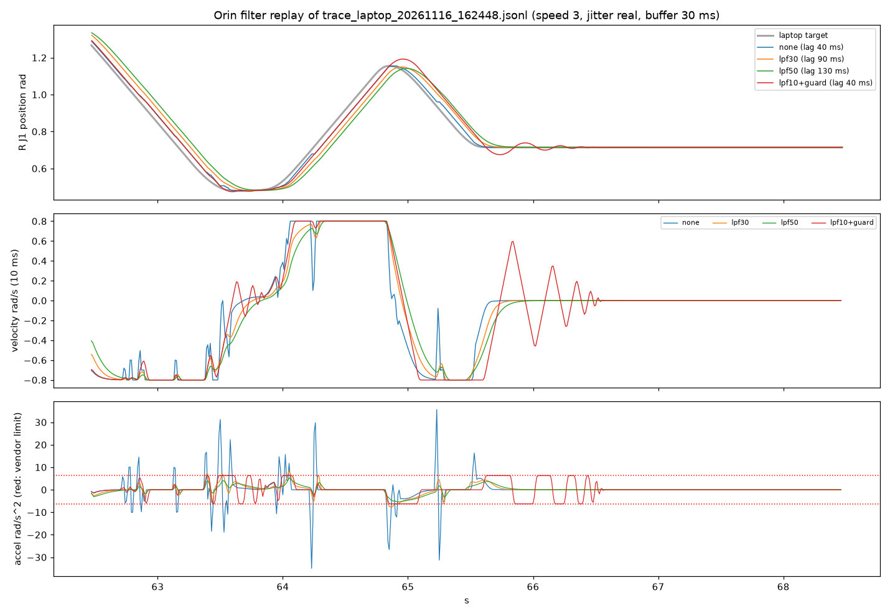

# Báo Cáo Rung Và Bộ Lọc Lệnh Tay (16/11)

## Tóm tắt

- **Cập nhật 17/11 – mặc định đã đổi sang cấu hình NHANH (bám 1:1 trước):** tốc độ **mức 6** cả hai bên, bộ đệm **30 ms**, lọc thông thấp trên Orin **tắt** (`PACER_SMOOTH_MS=0`), giới hạn gia tốc tắt, laptop `--smooth 1` (không có lọc đầu ra thứ hai). Cấu hình mượt 16/11 bên dưới vẫn chạy được bằng `PLAYOUT_MS=50 PACER_SMOOTH_MS=60 python arm_teleop_rx.py --speed 3` + `python main.py --speed 3 --smooth 3`. Thêm tùy chọn giới hạn riêng từng khớp trên Orin (`JOINT_VMAX`, `JOINT_AMAX`, `JOINT_TAU_MS`; cấu hình D / D1 trong `real_robot_command.md`).
- **Phát hiện 17/11:** MC 402 tự dao động ~10 Hz tỉ lệ với tốc độ khớp kể cả với lệnh dốc hoàn hảo phát ngay trên Orin (gấp ~4 lần PlanningMove), nên rung không do mạng hay bộ lọc; cổ tay J6/J7 rung gấp ~20 lần lệnh mượt của chính nó (bị vai / khuỷu kéo theo). Mode 205 không có trong menu SetAction của robot này; PlanningMove (403) thử cho Home 17/11 chậm và giật nên đã bỏ.
- **Mặc định 16/11 (cấu hình mượt nhất, nay không còn là mặc định):** lọc thông thấp 2 tầng **60 ms** và bộ đệm khử jitter **50 ms** trên Orin; **tắt** giới hạn gia tốc; tốc độ **mức 3**; laptop `--smooth 3` và `DIRECT_OUT_FIR2=10`; phát 400 Hz.
- **Trên robot (16/11):** rung đo được ở tốc độ vừa giảm từ 0,037 rad/s (không lọc) xuống 0,025 (cấu hình hiện tại), khoảng một phần ba; xem "Kết quả đo trên robot".
- **Hiệu quả so với không lọc** (phát lại cùng quỹ đạo thật, mạng giật như thật): lệnh bớt gồ ghề **khoảng 3 lần**, gia tốc đỉnh **40 → 12 rad/s²**, không vượt đích. Đổi lại **trễ thêm khoảng 90 ms**.
- **Giới hạn gia tốc làm tay đung đưa khi dừng:** lệnh dao động 4–5 lần sau mỗi lần dừng và vượt đích 17 mrad. Đây đúng là hiện tượng người vận hành thấy, nên giới hạn này tắt.
- **Trên robot:** lọc 30 ms được người vận hành đánh giá đỡ rung hơn không lọc (16/11). Cấu hình mượt nhất (bộ đệm 50 ms + lọc 60 ms) **chưa chạy trên robot**. Phát lại cho thấy riêng phần Orin đã đưa gia tốc đỉnh xuống 5,6 rad/s² (dưới giới hạn của hãng), lệnh mượt khoảng 4 lần, trễ thêm khoảng 140 ms.

## Kết quả đo trên robot (16/11)

Độ rung **đo được trên khớp robot** trong các phiên teleop ngày 16/11, mỗi phiên một cấu hình (nhận biết qua mã băm receiver ghi trong trace). Số là RMS của phần vận tốc dao động nhanh (vận tốc trừ trung bình trượt 0,2 s, rad/s); cột chính là trung bình J1–J5, cột cổ tay là J6–J7.

| Phiên (giờ Orin) | Cấu hình | Tay phải, tốc độ vừa (0,3–0,7 rad/s): chính / cổ tay | Mọi đoạn chuyển động (có trọng số): chính / cổ tay | Người vận hành |
| :--- | :--- | :--- | :--- | :--- |
| 17:22 | mức 3, lọc 10 + giới hạn gia tốc 2 chiều, đệm 50, vendor | **0,052** / 0,027 | 0,049 / 0,021 | rất rung, đung đưa khi dừng |
| 17:27 | mức 3, không lọc (như checkpoint 13/11), đệm 30 | 0,037 / 0,027 | 0,033 / 0,031 | |
| 17:34 | mức 3, lọc 30, đệm 30 | 0,031 / 0,016 | 0,027 / 0,026 | đỡ rung hơn |
| 17:41 | mức 2, lọc 60, đệm 50, laptop `--smooth 3` | 0,027 / 0,014 | 0,023 / 0,018 | |
| **17:49** | **mức 3, lọc 60, đệm 50, laptop `--smooth 3` (mặc định 16/11)** | **0,025** / 0,018 | **0,021** / 0,022 | |
| 16:54 | online planning (action 408, đã bỏ) | 0,023 / 0,031 | 0,015 / 0,028 | hết rung nhưng chậm |

**Kết luận từ bảng:**
- **Lọc lệnh làm robot rung ít đi thật.** Ở cùng mức 3 và cùng dải tốc độ, rung các khớp chính giảm từ 0,037 (không lọc) xuống 0,031 (lọc 30) và 0,025 (lọc 60 + laptop mượt nhất), tức **giảm khoảng một phần ba**. Vậy độ gồ ghề của lệnh, chủ yếu do mạng giật, là **một nguyên nhân đáng kể**, không chỉ là yếu tố phụ.
- **Giới hạn gia tốc 2 chiều làm rung tệ nhất** (0,052), khớp với việc người vận hành thấy rung mạnh và đung đưa.
- Cổ tay giảm ít hơn (0,027 xuống 0,018) và dao động nhiều giữa các phiên.

**Giới hạn của số liệu:**
- Đây là trace của receiver, lấy mẫu trạng thái khớp theo nhịp của receiver (khoảng hở tới 40–230 ms), nên số **chỉ dùng để so tương đối** giữa các phiên, không so được với số PlanningMove.
- Mỗi phiên là một chuyển động tay khác nhau.
- Cấu hình của từng phiên là cấu hình mặc định của bản receiver đó; nếu lúc chạy có gõ thêm biến môi trường thì không ghi lại được.

## Nguyên nhân cốt lõi của rung (cập nhật sau khi đo)

**Đính chính:** phiên bản trước của mục này nói "lệnh đã phẳng mà robot vẫn rung" (dựa trên trace 15:48). Bằng chứng đó **sai**: công cụ phân tích lúc đó ghép đồng hồ của receiver với đồng hồ của MC, nên lệnh bị đặt lệch thời gian và độ gồ ghề của lệnh luôn ra 0. Lỗi đã sửa trong `tools/vibration_report.py`.

Kết luận hiện tại có hai phần:
1. **Lệnh gồ ghề do mạng giật là một nguyên nhân đáng kể.** Lọc lệnh trên Orin đã giảm rung đo được khoảng một phần ba (bảng trên). Phát lại cho thấy không lọc thì lệnh có gia tốc đỉnh 40 rad/s², gấp 6 lần giới hạn của hãng.
2. **Phần còn lại nhiều khả năng do robot**, nhưng **chưa chứng minh được**:
   - Cùng robot chạy PlanningMove (quỹ đạo sinh trong MC, chế độ 403) ở 0,9 rad/s gần như không rung, cổ tay đứng yên.
   - Phân tích ngày 13/11: bàn tay lắc quanh cổ tay ở chỗ cảm biến khớp không thấy, dải rộng 5–50 Hz, tức là có độ mềm cơ khí.
   - Để tách phần còn lại giữa lệnh và robot, cần trạng thái khớp **đủ 100 Hz**, tức ghi bằng `cmd_recorder.py` (xem "Cách xác nhận").

### Các yếu tố làm nặng thêm

| Yếu tố | Mức ảnh hưởng | Tình trạng |
| :--- | :--- | :--- |
| Mạng giật làm lệnh có bậc nhảy | Gia tốc lệnh đỉnh 40 rad/s², gấp khoảng 6 lần giới hạn 6,28 của hãng | Bộ đệm 50 ms + lọc 60 ms: còn 5,6 rad/s² (phát lại); rung đo được giảm khoảng một phần ba |
| Tốc độ cao | Mức 6 (2,0 rad/s, 6,28 rad/s²) sát giới hạn phần cứng, rung mạnh nhất (16/11) | Mặc định mức 3 (mức 4 vẫn rung nhẹ, mức 5 bàn tay lắc quanh cổ tay) |
| Giới hạn gia tốc trên Orin (thử 16/11) | Lệnh dao động sau mỗi lần dừng; rung đo được cao nhất (0,052) | Đã tắt |
| Kế hoạch trên laptop | Gia tốc có lúc 8,7 rad/s² ngay cả khi mạng không giật | Chưa sửa |

### Cách xác nhận

Đo trong lúc teleop với cấu hình hiện tại, bằng trace **đủ 100 Hz**:

```bash
# Orin, terminal thứ hai (đã nạp môi trường ROS)
python3 cmd_recorder.py            # ghi trạng thái khớp + lệnh, file ở Desktop/logs/
# Laptop
scp 'agi@192.168.2.50:/agibot/data/home/agi/Desktop/logs/trace_recorder_*.jsonl' logs/
venv/bin/python tools/vibration_report.py $(ls -t logs/trace_recorder_*.jsonl | head -1) --plot
```

| Báo cáo ghi | Nghĩa | Việc tiếp theo |
| :--- | :--- | :--- |
| `robot shakes on a smooth command` | Phần rung còn lại do robot; phía mình không còn gì để lọc | Giảm tốc độ (`--speed 2`); kiểm tra cơ khí cổ tay và gá bàn tay; hỏi hãng về độ cứng cổ tay và cách xử lý lệnh ở chế độ 402 |
| `our command is rough` hoặc `partly our command` | Lệnh vẫn còn gồ ghề | Sửa kế hoạch trên laptop (gia tốc 8,7 rad/s²); thử lọc mạnh hơn |

Trace của receiver (`trace_orin_*`) **không dùng được** cho phép tách này, vì nó lấy mẫu lệnh và trạng thái quá thưa và không đều. Công cụ sẽ in cảnh báo khi gặp loại trace này.

## Trace đủ 100 Hz (16/11, 17:55): Orin bỏ đói tiến trình phát lệnh

Trace `trace_recorder_20261116_175509` (ghi bằng `cmd_recorder.py`, mọi lệnh + trạng thái 100 Hz) và `trace_orin_20261116_174944` cho kết quả rõ:

| Đo | Kì vọng | Thực tế |
| :--- | :--- | :--- |
| Tần số lệnh trên topic | 400 msg/s | 308 msg/s (pacer tự đo 326 Hz) |
| Khoảng hở giữa hai lệnh | 2,5 ms | p99 18 ms, **lớn nhất 139 ms**; 34 lần > 30 ms (giới hạn của hãng) trong 49 s |
| Nhịp pacer trễ hơn 2 lần chu kỳ | ~0 | 8,6% số nhịp |
| Receiver thức dậy trễ | vài ms | tới 135 ms |
| Rung của lệnh J1–J5, tay phải, dải vừa | nhỏ hơn rung đo được nhiều | 0,033 rad/s, **ngang** rung đo được (~0,029) |

**Nguyên nhân cốt lõi (đến giờ):** tiến trình pacer chạy ưu tiên thường trên một Orin đang tải nặng, nên có lúc bị dừng tới 140 ms. Khi chạy lại, nó đẩy một bước 16 mrad trong một lệnh, tức là vận tốc tức thời 5–6 rad/s, gấp đôi giới hạn 3 rad/s của hãng. Các cú giật này nằm ngay trong lệnh, không phải do mạng giữa laptop và Orin (bộ đệm 50 ms đã hấp thụ phần đó), và bộ lọc không cứu được vì chúng sinh ra **sau** bộ lọc.

**Cổ tay thì khác:** rung của lệnh J6–J7 nhỏ (0,005) trong khi rung đo được 0,02–0,045. Phần rung cổ tay nhiều khả năng đến từ robot (khớp mềm, bị cánh tay lay), khớp với phân tích 13/11.

**Đã sửa (chưa chạy trên robot):**
1. Pacer xin lịch chạy `SCHED_FIFO 30` (real-time); không xin được thì dùng `nice -10` và in CẢNH BÁO. Cần chạy `sudo prlimit --pid $$ --rtprio=30:30 --nice=40:40` trong terminal trước khi chạy receiver.
2. Sau một khoảng hở, bước lệnh bị chặn theo `max_vel × min(khoảng hở, 2 chu kỳ)`, nên không còn bước 16 mrad trong một lệnh; tay đuổi kịp sau vài nhịp.
3. `vibration_report.py` in thêm dòng `COMMAND STREAM` (tần số, khoảng hở p99/lớn nhất, số khoảng hở > 30 ms).

**Đo lại:** ghi lại bằng `cmd_recorder.py` như mục "Cách xác nhận". Kì vọng dòng `COMMAND STREAM` báo khoảng 400 msg/s và `0 gaps > 30 ms`; khi đó so lại rung lệnh với rung đo được của J1–J5.

## Trễ khi biên độ lớn (16/11, 17:40)

Đo trên log laptop của 4 phiên (tay phải, lúc bóp grip), đổi bàn tay sang toạ độ Descartes bằng FK:

| Đo | Kết quả |
| :--- | :--- |
| Tốc độ tay cầm khi di chuyển | trung vị 33–40 cm/s, p90 64–76 cm/s |
| Tốc độ bàn tay robot (mức 3–5) | trung vị 19–24 cm/s, tối đa 35–38 cm/s |
| Khoảng cách bàn tay robot đến đích | trung vị 11–17 cm, p90 25–28 cm; robot tụt sau đích > 8 cm trong 65–82% thời gian bóp grip |
| Khớp nhanh nhất lúc tụt sau | 0,72–0,82 rad/s, tức luôn chạm trần tốc độ; J1, J3, J4 chiếm hầu hết |
| Nhu cầu khớp | 3,1–3,7 rad cho mỗi mét tay đi; tối thiểu về động học cho cùng chuyển động chỉ 2,0–2,8 |

**Kết luận:** trễ lớn khi biên độ lớn chủ yếu do **trần tốc độ khớp** (mức 3 = 0,8 rad/s ≈ 25 cm/s ở bàn tay) trong khi tay người vung 30–70 cm/s. Đây là giới hạn vật lý của mức tốc độ, không phải lỗi đường truyền. Đoạn Orin và robot chỉ chiếm khoảng 0,2 s.

**Hai điểm tối ưu được (đã làm, mô phỏng lại trên chính log, chưa chạy trên robot):**
1. Điểm "carrot" (đích IK đặt trước bàn tay một đoạn) làm bộ giới hạn **phanh cho từng điểm trung gian** như thể đã tới đích. Nay khi đích thật còn xa hơn đoạn carrot, bộ giới hạn chạy thẳng qua không phanh (`XR_FAR_CRUISE=0` để tắt).
2. Đoạn carrot nới từ 6 lên **10 cm** (`XR_LEAD_POS_M`). Bàn tay lệch đường thẳng khoảng 7–8° thay vì 4–6°.

Kết quả mô phỏng mức 3, hai phiên:

| | Cũ | Mới |
| :--- | :--- | :--- |
| Thời gian robot tới đích sau khi tay dừng (trung vị / lâu nhất) | 0,92 s / 6 s (phiên 17:38), 0,41 s / 6 s (phiên 17:27) | 0,36 s / 1,8 s, 0,25 s / 6 s |
| Khoảng cách tới đích (trung vị) | 9,6 cm, 11,3 cm | 7,8 cm, 8,3 cm |

Thử thu nhỏ tỉ lệ tay cầm (0,5–0,7) làm trễ biến mất nhưng đổi 1:1 thành tỉ lệ khác, nên không dùng. Mức 5 giảm thêm (khoảng cách trung vị 4–5 cm) nhưng làm bàn tay lắc quanh cổ tay.

## Tay tự chuyển động, rung và trễ: kết luận 16/11 (18:00)

**Tay tự chuyển động khi tay cầm đứng yên.** Log phiên 17:56: sau khi nhả, bàn tay đã ở đích (lệch 3 mm) nhưng J1 xoay 0,85 rad trong 1,6 s, lần khác J5 xoay 0,26 rad trong 1 s. Nguyên nhân: IK vẫn được giải lại liên tục, nên các thành phần tư thế (lò xo đẩy khuỷu ra ngoài, hướng bàn tay mềm, tư thế nghỉ) tiếp tục xoay khớp trong khi bàn tay đứng yên; ở chế độ tịnh tiến, pha "coast" còn kéo dài tới 4 s vì chờ hướng bàn tay. Đã sửa (`XR_HOLD_STILL`): tay cầm đang giữ hoặc đã nhả mà đích không đổi và bàn tay đã ở đích thì giữ nguyên nghiệm IK. Mô phỏng: khớp tự xoay sau khi nhả 0,12–0,19 rad → 0.

**Rung không phụ thuộc mức tốc độ mà phụ thuộc tốc độ khớp tức thời.** Rung J1–J5 đo từ log laptop, cùng dải tốc độ khớp:

| Phiên | Mức | chậm / vừa / nhanh (rad/s) |
| :--- | :--- | :--- |
| 16:47 (pacer chưa real-time) | 3 | 0,031 / 0,077 / 0,150 |
| 17:27 | 4 | 0,018 / 0,036 / 0,044 |
| 17:33 | 5 | 0,014 / 0,026 / 0,040 |
| 17:38 | 4 | 0,016 / 0,034 / 0,055 |
| 17:56 | 3 | 0,016 / 0,034 / 0,046 |

Pacer real-time đã giảm rung 2–3 lần. Phần còn lại bằng nhau ở mức 3, 4, 5: khoảng 5–7% tốc độ khớp, là phản ứng của robot với lệnh stream. Hạ mức tốc độ không làm một chuyển động chậm êm hơn; nó chỉ cấm các chuyển động nhanh.

**Trễ phụ thuộc vùng làm việc.** Phiên 17:56 bàn tay cách vai trung vị 30 cm, khuỷu gập kịch giới hạn 52% thời gian: cần 4,6 rad cho mỗi mét (tối thiểu động học 3,9–4,2), bàn tay robot chỉ đi 15 cm/s. Các phiên bàn tay cách vai 43–45 cm: 3,0 rad/m, 25 cm/s.

**Đã thử và không dùng:** IK vi phân có trần tốc độ ngay trong bài toán tối ưu (mọi khớp cùng chạy tới trần). Một phiên nhanh hơn (36 so với 27 cm/s) nhưng đường đi lệch 17–23°, phiên kia bị kẹt không tới đích.

## Phân tích độc lập có phản biện (16/11, 19:00)

Bốn hướng phân tích chạy song song trên log và code, mỗi kết quả được một người phản biện chạy lại độc lập. Dữ liệu chính: phiên laptop `20261116_181601` cùng trace Orin đủ 100 Hz `trace_recorder_20261116_191840` (pacer real-time, mức 3, mặc định).

**Đính chính hai kết luận trước:**
- "Pacer real-time giảm rung 2–3 lần" là **sai**, do đo theo thời điểm gói tin tới laptop. Đo đúng theo dấu thời gian của MC: rung giảm **34–42%** (0,039/0,054/0,061 → 0,023/0,034/0,040 rad/s).
- Tín hiệu vị trí khớp của robot tự có một "sàn rung" tỉ lệ với tốc độ: mỗi khớp báo theo lưới riêng khoảng 4 ms, nên bước 10 ms xen kẽ 0,8× và 1,2×. Vì vậy PlanningMove (người vận hành thấy rất êm) cũng đọc ra 4,1–5,7% tốc độ khớp; teleop mặc định hiện tại là 7,6–8,7%; trước real-time là 10,6–12,7%.

**Rung còn lại không nằm trong lệnh mình gửi.** Lệnh Orin phát ra khớp với mô phỏng lại luồng laptop qua đúng các lớp của receiver tới 0,2 mrad. Robot bám lệnh dưới 5 Hz (tỉ lệ 0,97–0,98, trễ khoảng 60–65 ms), nhưng ở 5–50 Hz chuyển động đo được lớn gấp 7–13 lần nội dung của lệnh. Cổ tay đo được lớn gấp 10 lần lệnh cổ tay. Thêm lọc phía mình không giảm được phần này. Khoảng hở > 30 ms thấy trong trace là do bộ ghi đánh rơi tin nhắn, không phải do pacer.

**Ngân sách trễ cho cử động nhỏ (khoảng 400–470 ms từ đích IK tới khớp):**

| Khâu | ms |
| :--- | :--- |
| Follower + IK + vòng gửi | khoảng 15–20 |
| Bộ giới hạn laptop (lõi) | 20–23 (tăng theo tốc độ) |
| Trung bình trượt laptop FIR 12 + 10 | 100 |
| Bộ đệm khử jitter Orin | 50 |
| Lọc thông thấp Orin 60 ms × 2 | 117,5 (bằng 2τ, không phải τ) |
| MC + khớp | 60–66 |

Làm mượt bị lặp: khi đã có lọc Orin, FIR laptop chỉ thêm rất ít độ mượt cho 100 ms trễ của nó.

**Đã áp dụng (đã qua phản biện):**
1. Khóa cổ tay J6/J7 khi chỉ tịnh tiến (`WRIST_FREEZE_SOFT`). Sửa lỗi cổ tay tự quay ~17° sau Home (tái hiện: 0 → 0,30/−0,20 rad khi nâng 7,5 cm; sau khi sửa: 0) và bỏ lệnh cổ tay khi tịnh tiến, vốn được ước tính làm rung cổ tay tăng 60–80%.
2. Khóa trục mềm: lúc chưa đủ nhanh để chọn trục thì đi tự do theo tay thay vì đứng chờ (đích bắt đầu sớm hơn 12–24 ms; cử động chậm 2 cm không còn bị bỏ qua).
3. Receiver gửi về tình trạng pacer và dấu thời gian MC; laptop cảnh báo khi pacer không real-time hoặc có khoảng hở. Log `real_*.jsonl` có thêm `measured_stamp_mc`.
4. `cmd_recorder.py`: hàng đợi 20 → 200 để không đánh rơi tin nhắn.

**Đề xuất thử A/B (chưa đổi mặc định):** `DIRECT_OUT_FIR=6 DIRECT_OUT_FIR2=4 python main.py` bớt chính xác 60 ms trễ cố định. Phát lại trên 3 phiên: độ gồ ghề của lệnh 0,0064 → 0,0071 rad/s, gia tốc đỉnh +0,2–0,4 rad/s². Chưa biết ảnh hưởng tới việc bàn tay lắc khi dừng; giữ lọc Orin 60 ms.

**Bị bác (không làm):** tắt hẳn FIR laptop (an toàn phụ thuộc vào cấu hình máy kia); bộ đệm 30 ms; lọc Orin 40 ms; giữ khớp theo thời gian dừng; thu nhỏ vùng chết 2 mrad; giữ nghiệm IK cũ khi chưa hội tụ; sửa nhịp gửi UDP; bù dẫn trước phía gửi. Lý do: không có lợi trên log thật, hoặc lợi quá nhỏ so với rủi ro.

## Cách đo

Công cụ [`tools/filter_report.py`](../tools/filter_report.py) lấy **quỹ đạo lệnh thật** laptop đã gửi trong một phiên chạy robot (`logs/trace_laptop_<giờ>.jsonl`, trường `sent_q14`, 100 Hz) và phát lại qua **đúng code của Orin** (`scripts/orin_teleop_core.py`):

1. **Thời điểm gói tin tới** theo mô hình mạng thật: trễ khoảng 2 ms kèm đuôi dài, gói tới theo cặp, và cứ khoảng 0,5 s có 3–4 gói bị giữ 20–50 ms.
2. **Bộ đệm khử jitter** `PlayoutBuffer` (30 ms).
3. **Bộ lọc** đang so sánh: `JointSmoother` (lọc thông thấp `y = (1-a)·y + a·x`, 2 tầng) hoặc `OneEuroFilter`.
4. **Giới hạn gia tốc** `accel_guard` (nếu bật), rồi giới hạn tốc độ và bước tối đa mỗi lệnh.
5. **Phát lệnh 400 Hz.** Các chỉ số đo trên lệnh mới nhất mỗi 10 ms, tức đúng thứ robot nhận.

Dữ liệu: phiên `trace_laptop_20261116_162448` (93 s điều khiển bằng tay cầm, mức 3). Phiên 16:32 cho kết quả tương tự. Kết quả lặp lại đúng giữa các lần chạy.

Công cụ chỉ đo **lệnh mình gửi**. Robot vẫn có thể rung trên một lệnh mượt; phần đó đo bằng [`tools/cmd_recorder.py`](../tools/cmd_recorder.py) trên Orin cộng [`tools/vibration_report.py`](../tools/vibration_report.py).

## Kết quả

| Cấu hình | Trễ (ms) | Độ gồ ghề lệnh (rad/s) | Gia tốc đỉnh (rad/s²) | Chuyển động khi đích đứng yên (rad/s) | Vượt đích (mrad) |
| :--- | ---: | ---: | ---: | ---: | ---: |
| Không lọc (checkpoint 13/11) | 40 | 0,036 | 40,0 | 0,00005 | 0 |
| Lọc 10 ms | 50 | 0,027 | 30,3 | 0,00008 | 0 |
| Lọc 30 ms | 90 | 0,017 | 20,2 | 0,0005 | 0 |
| Lọc 50 ms | 130 | 0,012 | 11,8 | 0,0016 | 0 |
| Lọc 60 ms | 150 | 0,011 | 8,5 | 0,0023 | 0 |
| **Bộ đệm 50 ms + lọc 60 ms (mặc định)** | **170** | **0,009** | **5,6** | **0,0029** | **0** |
| One Euro (1,5 Hz; β 0,5) | 70 | 0,025 | 28,1 | 0,0005 | 0 |
| Kalman (q 20, r 1e-4) + lọc 30 ms | 90 | 0,017 | 22,4 | 0,0005 | 0 |
| Lọc 10 ms + giới hạn gia tốc 6,28 | 40 | 0,043 | 6,3 | **0,0062** | **17,2** |

**Cách đọc các cột:**
- **Trễ:** độ dịch thời gian khớp đầu ra với quỹ đạo laptop nhất. Là cái giá của việc lọc.
- **Độ gồ ghề lệnh:** RMS của vận tốc lệnh trừ trung bình trượt 0,2 s, khi tay đang chạy. Là phần bậc thang và giật còn sót trong lệnh.
- **Gia tốc đỉnh:** trên chu kỳ 10 ms. Giới hạn của hãng là 6,28 rad/s².
- **Chuyển động khi đích đứng yên:** dao động hoặc trôi sau khi tay người dừng. Lọc thông thấp làm tay tiến dần vào đích (không dao động), còn giới hạn gia tốc làm tay **dao động qua lại**.
- **Vượt đích:** đi quá vị trí dừng.

Khi phát lại **không có giật mạng**, chính quỹ đạo laptop chỉ gồ ghề 0,014 rad/s, nhưng gia tốc đỉnh vẫn **8,7 rad/s²** (vượt giới hạn của hãng). Vậy:
- Phần lớn độ gồ ghề của lệnh **do mạng giật**, và bộ lọc gỡ được.
- Còn một phần nhỏ **do kế hoạch trên laptop**, cần sửa phía laptop nếu muốn tuân thủ tuyệt đối.



Trong ảnh (khớp vai phải, đoạn 62–68 s):
- **Xanh dương (không lọc):** các gai gia tốc 30–35 rad/s² mỗi khi gói tin tới dồn.
- **Cam và xanh lá (lọc 30 / 50 ms):** mượt, trễ hơn một chút.
- **Đỏ (giới hạn gia tốc):** sau khi đích dừng ở khoảng 65,7 s, lệnh dao động 4–5 nhịp trong khoảng 1 s.

## Bộ lọc Kalman

Đã thêm bộ lọc Kalman vận tốc không đổi cho từng khớp (`PACER_FILTER=kalman`, tham số `KALMAN_Q`, `KALMAN_R`, `KALMAN_LPF_MS`). Quét 12 cặp tham số trên cùng quỹ đạo (bộ đệm 50 ms):

| Cấu hình | Trễ (ms) | Độ gồ ghề | Gia tốc đỉnh | Vượt đích (mrad) |
| :--- | ---: | ---: | ---: | ---: |
| Không lọc | 50 | 0,022 | 40,0 | 0 |
| Kalman đơn, tốt nhất (q 5, r 1e-2) | 60 | 0,019 | 27,2 | 5,9 |
| Kalman (q 5, r 1e-3) + lọc 30 ms | 110 | 0,014 | 13,3 | 0,3 |
| Lọc 30 ms | 110 | 0,013 | 16,2 | 0 |
| Kalman (q 5, r 1e-3) + lọc 60 ms | 170 | 0,010 | 5,3 | 0 |
| **Lọc 60 ms (mặc định)** | **170** | **0,009** | **5,6** | **0** |

Kalman đơn **trễ ít** nhưng **gần như không làm mượt**: nhiễu ở đây chủ yếu là các bậc nhảy do gói tin tới dồn, Kalman hiểu chúng là thay đổi vận tốc và bám theo, còn khi lọc mạnh hơn thì bắt đầu vượt đích. Ghép thêm lọc thông thấp thì kết quả ngang với lọc thông thấp cùng độ trễ, không tốt hơn. Vì vậy mặc định giữ lọc thông thấp 60 ms; Kalman có sẵn để thử (`PACER_FILTER=kalman KALMAN_Q=5 KALMAN_R=1e-3 KALMAN_LPF_MS=30`).

## Vì sao giới hạn gia tốc gây đung đưa

Lớp giới hạn bám theo đích với gia tốc tối đa 6,28 rad/s² cả hai chiều và phanh theo "đường phanh". Khi đích dừng hơi gấp (do mạng giật hoặc do kế hoạch laptop có lúc 8,7 rad/s²), lớp này phanh ở đúng mức tối đa rồi dừng đột ngột. Sai số rời rạc khiến nó đi lố, quay lại, rồi lố lần nữa. Lọc thông thấp không có hiện tượng này vì cả hai tầng đều tắt dần, không bao giờ vượt.

## Thay đổi mặc định và cách chỉnh

| Biến (trên Orin, trước `python arm_teleop_rx.py`) | Mặc định | Gợi ý |
| :--- | :--- | :--- |
| `PACER_SMOOTH_MS` | 0 (tắt, từ 17/11; 16/11 là 60) | 20 / 30 (êm hơn, trễ thêm), 60 (mượt nhất, trễ nhiều) |
| `PACER_FILTER` | lọc thông thấp | `kalman` (xem mục Kalman), `oneeuro` (lọc thích nghi theo tốc độ; trên dữ liệu này không tốt hơn) |
| `PACER_MAX_ACC` | 0 (tắt) | Không nên bật: gây đung đưa khi dừng |
| `PLAYOUT_MS` | 30 (từ 17/11; 16/11 là 50) | 50: thêm 20 ms trễ, chịu mạng giật tốt hơn |
| `JOINT_VMAX` / `JOINT_AMAX` / `JOINT_TAU_MS` | **D (từ 17/11)**: 1.2,1.5,1.2,1.5,2,2,2 / 6 / tắt; `off` để tắt | `JOINT_VMAX=1.2,1.5,1.2,1.5,2,2,2 JOINT_AMAX=6` (D) hoặc `JOINT_AMAX=8` (D1); `JOINT_AMAX` phải đi kèm `JOINT_VMAX` |
| `--speed` (cả `main.py` lẫn receiver) | 6 (từ 17/11; 16/11 là 3) | 5 / 4 / 3: chậm hơn, êm hơn |
| `main.py --smooth` / `DIRECT_OUT_FIR2` | 1 / 1 (tắt) (từ 17/11; 16/11 là 3 / 10) | 3 / 4: êm hơn, trễ hơn |

Tự chạy báo cáo trên một phiên mới (sau khi phiên đó kết thúc, vì trace còn đang ghi sẽ cho số khác nhau giữa các lần):
```bash
venv/bin/python tools/filter_report.py logs/trace_laptop_<giờ>.jsonl
venv/bin/python tools/filter_report.py logs/trace_laptop_<giờ>.jsonl --configs none,lpf30,lpf50,lpf60 --playout 50
venv/bin/python tools/filter_report.py logs/trace_laptop_<giờ>.jsonl --raw --speed 6 --configs none,joint-k3,joint-k1   # phát lại đầu ra IK; có thêm joint-k2, acc8
```

## Việc còn lại

0. **Chạy pacer real-time** (`prlimit` ở trên) và đo lại bằng `cmd_recorder.py`; kiểm tra `0 gaps > 30 ms`.
1. **Chạy lọc 50 ms trên robot** và so cảm giác với 30 ms. Nếu trễ khó chịu, quay về `PACER_SMOOTH_MS=30`.
2. **Đo rung thật của robot** bằng `cmd_recorder.py` + `vibration_report.py`, để biết phần rung còn lại do lệnh hay do robot.
3. **Phía laptop:** kế hoạch đôi lúc có gia tốc 8,7 rad/s². Tìm và giới hạn chỗ đó để lệnh tuân thủ khuyến nghị của hãng ngay từ nguồn.
